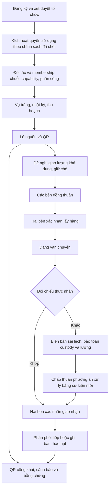

# Đề xuất chỉnh sửa chức năng nghiệp vụ AgriTrace

Trạng thái: **đề xuất để chủ dự án xem xét, chưa phải đặc tả đã duyệt**.
Ngày lập: 18/10/2026, giờ Việt Nam.

Tài liệu đề xuất phạm vi sản phẩm và luồng nghiệp vụ dựa trên checkout đang làm
dở. Không thay đổi code, schema, dữ liệu, quyền tài khoản hoặc quyết định triển
khai hiện hành. Các mục ghi “đã có” chỉ có nghĩa là đã tìm thấy trong source local,
không xác nhận chúng đã được nghiệm thu runtime hoặc triển khai production.

## 1. Hướng sản phẩm nên chốt

Đề xuất này rà soát và hoàn thiện **truy xuất nông sản trồng trọt qua nhiều tổ
chức** theo mô hình AgriTrace hiện hành: tạo nguồn từ vụ trồng và thu hoạch,
theo dõi lượng hàng của từng bên, ghi nhận bàn giao, xử lý sai lệch và công bố
bằng chứng qua QR. Chức năng được phân tích theo nhu cầu của tổ chức sản xuất,
vận chuyển, phân phối, bán lẻ, admin và thành viên trong từng tổ chức.

Giữ mô hình lõi `ProductionCycle → HarvestEvent → Lot`. Một lần thu hoạch tạo
một lô nguồn; một vụ có nhiều lần thu hoạch. Sau đó lô đi theo một trong hai
đường đang có: `Shipment` hiện hành hoặc phân phối qua `LotHolding` và
`DistributionTransfer`. Mỗi dòng phân phối luôn chỉ về lô nguồn ban đầu.

Điều chỉnh quan trọng nhất:

1. Hoàn thiện nhận hàng thực tế, thiếu/hỏng/từ chối/trả hàng và thu hồi khi hàng
   đang trên đường; không chỉ hoàn thành luồng giao đủ.
2. Xác định lượng theo kho/cửa hàng nếu sản phẩm tiếp tục hỗ trợ nhiều cơ sở và
   nhân viên được giới hạn theo cơ sở.
3. Tách quyền theo thao tác và trách nhiệm; cấp thành viên không thay cho quyền
   nghiệp vụ hoặc năng lực tổ chức.
4. Cung cấp hộp công việc, sự cố và hỗ trợ cho cả bốn nhóm doanh nghiệp.
5. Gắn bổ sung giống, vật tư, tài liệu, ảnh và chứng nhận vào vụ, lô và hành trình
   truy xuất tương ứng.
6. Giữ ranh giới giữa giao nhận mới và signed intent c2. Chỉ mở phân phối mới
   trên chuỗi bắt buộc chữ ký sau khi tích hợp và nghiệm thu riêng.

## 2. Căn cứ và giới hạn khảo sát

### 2.1. AgriTrace đang được đối chiếu

- Checkout: `C:\Users\kieup\Desktop\agri-trace-blockchain`.
- Branch kiểm tra lúc bắt đầu: `chore/revert-mobile-app-foundation`.
- HEAD: `580c8d6f4f6c1be42c86bc8af4b8d3a50a83e1fe`.
- Working tree có nhiều file sửa và file mới chưa commit. Những phần enterprise,
  distribution và platform-governance được đọc từ working tree này; SHA HEAD
  riêng lẻ không đại diện đầy đủ cho bản đang phân tích.
- Không có `.codegraph/` tại gốc; sử dụng tìm kiếm và đọc source trực tiếp.
- Không chạy command nghiệp vụ, migration, E2E, Fabric, SSH, GitHub hoặc production
  trong tác vụ phân tích này. Các acceptance bên dưới là yêu cầu đề xuất.

Nguồn chính:

| Mã | Nguồn | Mục đích đối chiếu |
| --- | --- | --- |
| S01 | [README](../../README.md), [PROJECT_CONTEXT](../PROJECT_CONTEXT.md) | Mô hình, phạm vi local và giới hạn nghiệm thu |
| S02 | [Business rules](../core-business-rules.md), [ADR-001](../adr-001-modular-monolith-dedicated-worker.md), [ADR-004](../adr-004-hybrid-binding-and-signatures.md) | Quyền, quantity/custody, recovery và chữ ký |
| S03 | [Prisma schema](../../apps/api/prisma/schema.prisma) | Tổ chức, thành viên, vụ, lô, giao nhận, holding |
| S04 | [Enterprise policy](../../apps/api/src/modules/enterprise-workspace/enterprise-policy.ts), [workspace service](../../apps/api/src/modules/enterprise-workspace/enterprise-workspace.service.ts), [DTO](../../apps/api/src/modules/enterprise-workspace/dto.ts) | Quyền, ủy quyền cấp 1–2–3 và đối tác |
| S05 | [Distribution service](../../apps/api/src/modules/distribution/distribution.service.ts), [controller](../../apps/api/src/modules/distribution/distribution.controller.ts), [DTO](../../apps/api/src/modules/distribution/dto.ts) | Giao nhận, chữ ký, đối soát, ghi giảm, cảnh báo |
| S06 | [Lot query](../../apps/api/src/modules/lots/lot-query.service.ts), [lot commands](../../apps/api/src/modules/lots/lot-commands.controller.ts), [shipments](../../apps/api/src/modules/shipments/shipments.controller.ts) | Hai đường nghiệp vụ và QR công khai |
| S07 | [Catalog](../../apps/api/src/modules/catalog/catalog.module.ts), [production controller](../../apps/api/src/modules/production-cycles/production-cycles.controller.ts), [production UI](../../apps/web/src/components/workspace/production.tsx) | Danh mục, nhật ký và thu hoạch |
| S08 | [Enterprise onboarding](../../apps/api/src/modules/enterprise-onboarding/enterprise-onboarding.service.ts), [service](../../apps/api/src/modules/enterprise-onboarding/enterprise-service.service.ts), [onboarding plan](enterprise-onboarding.md) | Đăng ký, xét duyệt, kích hoạt và kết nối |
| S09 | [Platform controller](../../apps/api/src/modules/platform-governance/platform-governance.controller.ts), [platform plan](platform-governance.md) | Quản trị, kiểm toán, sự cố và quyền riêng tư |
| S10 | [Frontend guide](../frontend.md), [app frame](../../apps/web/src/components/app-frame.tsx), [enterprise access](../../apps/web/src/lib/enterprise-access.ts), [permissions](../../apps/web/src/lib/permissions.ts) | Điều hướng và phạm vi màn hình |

Đặc tả `Batch` trong archive chỉ là bối cảnh lịch sử. Không chuyển mô hình hiện
hành về `Batch`, không coi plan hoặc tên migration là bằng chứng đã chạy.

### 2.2. Phạm vi tham khảo iCheck

Nguồn: [trang hướng dẫn iCheck Trace](https://trace.icheck.vn/vn/user-manual-support).
Đã đọc toàn bộ nội dung chữ của 12 mục hướng dẫn và xem toàn bộ 117 URL ảnh
riêng được nhúng bằng thẻ `img` trên trang. Đây là khảo sát tài liệu và ảnh màn
hình công khai, không phải kiểm thử hệ thống quản trị iCheck đang đăng nhập.

HTML được kiểm kê có 124 lượt thẻ ảnh, 117 URL ảnh riêng; 106 URL thuộc
`assets/images2`, gồm 12 biểu tượng mục và 94 ảnh/biểu tượng trong phần hướng dẫn.
Các ảnh logo, ngôn ngữ và tải ứng dụng được tính riêng. Đây là số URL, không
phải số màn hình nghiệp vụ khác nhau.

Trong 117 URL có **92 ảnh màn hình nghiệp vụ, 14 biểu tượng và 11 ảnh logo/ngôn
ngữ/tải ứng dụng**. Tất cả tệp tải và giải mã ảnh thành công. Đã xem các ảnh theo
thứ tự của trang bằng trình xem ảnh; các form dài được mở thêm ở kích thước gốc.
Ảnh lặp được nhận diện theo nội dung, không tính thành chức năng mới.

Giới hạn kết luận: chỉ đánh giá phần chữ và nội dung nhìn thấy trong ảnh gốc.
Không suy ra policy backend, hành vi sau khi bấm nút, trường ngoài vùng ảnh hoặc
trạng thái triển khai hiện tại của iCheck. Không có ảnh hướng dẫn riêng cho mọi
vai sản xuất/vận chuyển/phân phối/bán lẻ/admin. Các phần chưa được tài liệu mô tả
được ghi là **chưa có bằng chứng trong tài liệu này**, không kết luận iCheck
không có chức năng đó. Phụ lục A có ghi nhận theo từng ảnh và liên kết nguồn.

So sánh dưới đây là quyết định thiết kế riêng cho AgriTrace sau khi đối chiếu
source; iCheck chỉ cung cấp nhóm nhu cầu tham khảo.

### 2.3. So sánh trực tiếp theo nội dung và ảnh

| Nhóm | Quan sát được từ iCheck | AgriTrace hiện có trong source | Đề xuất phù hợp AgriTrace |
| --- | --- | --- | --- |
| Thành viên | [Hồ sơ](https://trace.icheck.vn/assets/images2/img-2.png) chứa loại nông trại, vùng/xưởng, diện tích, sản lượng; [nhóm quyền](https://trace.icheck.vn/assets/images2/img-5.png) có các mẫu chọn | Tài khoản cấp 1–2–3 và scope chuỗi/cơ sở (S04) | Tách người dùng, hộ/tổ chức và vùng sản xuất; bổ sung mẫu quyền theo công việc |
| Tem | [Kích hoạt](https://trace.icheck.vn/assets/images2/anti-img10.png) gắn dải serial với lô; [cảnh báo](https://trace.icheck.vn/assets/images2/anti-img13.png) có ngưỡng lượt quét | QR giữ nguyên theo lô nguồn (S06) | Giữ QR lô; serial nếu có phải là module riêng, không dùng ngưỡng quét để trì hoãn recall |
| Vùng | [Form vùng](https://trace.icheck.vn/assets/images2/img-12.png) có mã, nhân sự, đầu vào và tài liệu | Farm/Plot, vụ và phân công; hồ sơ danh mục còn ít trường (S03, S07) | Bổ sung mã vùng nội bộ, evidence và liên kết; lượng hồ sơ vùng không thay lượng harvest |
| Nhà xưởng | [Hồ sơ cơ sở](https://trace.icheck.vn/assets/images2/img-18.png) có thông tin năng lực, vùng liên kết và tài liệu | EnterpriseSite có loại và địa chỉ (S03, S04) | Hoàn thiện cơ sở đóng gói/kho/cửa hàng; chưa suy ra tồn kho chỉ từ hồ sơ cơ sở |
| Đối tác | [Form liên kết](https://trace.icheck.vn/assets/images2/img-24.png) cho khai báo thông tin doanh nghiệp | Mời chủ thể đã đăng ký, hai bên phản hồi (S04) | Giữ quan hệ có chấp nhận; thêm mã AgriTrace cho hộ không có MST; không tạo tài khoản đối tác giả |
| Sản phẩm | [Form](https://trace.icheck.vn/assets/images2/img-31.png) có ảnh, nội dung sử dụng/bảo quản, tài liệu và các bên khai báo; [danh sách](https://trace.icheck.vn/assets/images2/img-36.png) có nhập Excel | Product có SKU/GTIN/variety/description; chưa có nhập hàng loạt hoặc thư viện ảnh sản phẩm trong catalog (S07) | Làm giàu hồ sơ sản phẩm, có snapshot; nhập danh mục theo mẫu và xem trước lỗi |
| Vật tư | [Hồ sơ đầu vào](https://trace.icheck.vn/assets/images2/img-40.png) có nhận diện, đơn vị cung ứng và tài liệu | Care có dữ liệu vật tư; chưa có danh mục đầu vào riêng trong phần catalog đã đọc (S03, S07) | Liên kết lần sử dụng vật tư với vụ, lượng, ngày và evidence |
| Giống | [Danh mục giống](https://trace.icheck.vn/assets/images2/user-manual-ud7.png) tách riêng, có nguồn cung và chứng cứ | Product.variety chưa tương đương hồ sơ nguồn giống (S03) | Thêm nguồn/lô giống ở vụ, không tạo giống mới cho mỗi lần thu hoạch |
| Phương tiện | [Form xe](https://trace.icheck.vn/assets/images2/img-48.png) có chủ xe/đơn vị; [phiếu vận chuyển](https://trace.icheck.vn/assets/images2/img-58.png) chọn tài xế | Xe gắn tổ chức/chặng; scope nhân viên chủ yếu theo chuỗi/cơ sở (S04, S05) | Thêm người thực hiện và scope theo chặng; chủ xe không tự là người ký |
| Lô/giao nhận | [Form lô](https://trace.icheck.vn/assets/images2/img-53.png) có nguồn/bao gói; [xuất hàng](https://trace.icheck.vn/assets/images2/img-60.png) có tùy chọn yêu cầu xác nhận nhập | Harvest sinh lô; transfer nhiều dòng/chặng có CONSENT/PICKUP/DELIVERY (S05, S06) | Kế thừa thông tin nguồn tự động, giữ đối soát và chữ ký bắt buộc theo policy; hoàn thiện sai lệch thực nhận |
| Nhật ký/hỗ trợ | [Nhật ký](https://trace.icheck.vn/assets/images2/img-62.png) có nhóm việc; [hỗ trợ](https://trace.icheck.vn/assets/images2/img-67.png) có đường dẫn theo nhu cầu | Có care, quan sát vận chuyển, landing FAQ và case (S05, S07, S09) | Mẫu công việc theo vai, hướng dẫn bắt đầu và hộp hỗ trợ dùng được cho cả bốn nhóm |
| Dịch vụ | [Form gói](https://trace.icheck.vn/assets/images2/img-69.png) có thời hạn, số sản phẩm/thành viên và lựa chọn blockchain | Catalog gói tham khảo, thanh toán local và connection probe riêng (S08) | Mô tả quyền sử dụng/hạn mức rõ; điều kiện kết nối và bằng chứng giữ độc lập |

### 2.4. Kết luận khách quan và chỗ tài liệu chưa chứng minh

Các ảnh iCheck thể hiện khá đầy đủ việc lập hồ sơ, chọn liên kết, bổ sung ảnh và
giấy tờ trên nhiều loại đối tượng. Đây là phần đáng học cho AgriTrace vì source
hiện có mô hình nghiệp vụ nhưng một số form danh mục còn đơn giản. Form dài nên
chia nhóm và chỉ hiện phần liên quan công việc, không cần chép nguyên mọi trường.

AgriTrace có source mô tả chi tiết harvest, giữ nguyên lô nguồn, đồng thuận,
quantity/custody và chữ ký. Tài liệu iCheck được cung cấp chưa đủ để so sánh sâu
các cơ chế đó. Không dùng việc đọc được source AgriTrace nhưng chỉ xem manual
iCheck để kết luận AgriTrace tốt hơn tổng thể hoặc iCheck thiếu các cơ chế này.

- Các bên khai trong danh mục sản phẩm là quan hệ đã khai báo. Hành trình thực
  tế trên QR AgriTrace phải lấy từ các lần giao nhận đã phát sinh.
- Phiếu iCheck có chọn kho và tùy chọn xác nhận nhập. Ảnh không chứng minh sổ
  tồn theo kho, quy tắc nhận thiếu, chống ghi trùng hoặc chữ ký độc lập. Đây là
  các yêu cầu đề xuất cho AgriTrace theo domain hiện tại.
- Sidebar và form gói có mục blockchain; ảnh không chứng minh loại mạng, cách
  giữ khóa, consensus hoặc nội dung được neo. Không đánh đồng một lựa chọn trên
  form với CONNECTED hay proof VERIFIED của AgriTrace.
- Ảnh xuất hiện nút sửa/xóa/nhân bản, nhưng không thấy kết quả sau thao tác. Không
  khẳng định iCheck xóa/sửa lịch sử đã neo; với AgriTrace vẫn giữ invariant cũ.
- Không có đủ mô tả trong trang này về dashboard riêng cho nhà phân phối/bán lẻ,
  phân quyền tới từng kho/chặng, quy trình thu hồi liên tổ chức, sensor window,
  MFA hay phục hồi command. Các nội dung đề xuất tương ứng dựa vào AgriTrace.

Chữ và ảnh có một số điểm không khớp: ảnh sửa thành viên dùng lại ảnh thêm
(`img-2`/`img-6` giống byte); thêm/sửa doanh nghiệp liên kết cũng dùng lại ảnh
(`img-24`/`img-26`). Ở phần vật tư, `img-41` tô nút tải QR trong khi đoạn chữ nói
sửa; phần gói ghi xóa nhưng `img-71` là form chuyển đổi. Nhiều ảnh có dữ liệu
năm 2022. Các điểm này giới hạn độ chắc chắn khi suy ra giao diện hiện hành;
không phải kết luận lỗi của sản phẩm đang chạy.

### 2.5. Chọn trường dữ liệu từ mẫu tham khảo

| Đối tượng AgriTrace | Nên bổ sung | Cách gắn vào mô hình hiện tại |
| --- | --- | --- |
| Tổ chức | Hồ sơ giới thiệu/ảnh công khai được duyệt, mã AgriTrace | Giữ hồ sơ pháp lý riêng tư; không nhập chủ thể độc lập như nhân viên |
| Farm/Plot | Mã nội bộ, ảnh, người phụ trách, tài liệu vùng và liên kết cơ sở | Sản lượng dự kiến/năng lực là metadata; HarvestEvent là lượng nguồn thực tế |
| Product | Ảnh, bảo quản, hướng dẫn dùng khi cần, tài liệu được công bố | Nhà sản xuất/nguồn lấy theo dữ liệu hợp lệ của vụ/lô; phiên bản thông tin không sửa chứng cứ cũ |
| Vật tư/giống | Mã nội bộ, nguồn cung, lô đầu vào, evidence và đơn vị dùng | Danh mục nhận diện và lần sử dụng ở vụ là hai bản ghi khác nhau |
| EnterpriseSite | Ảnh, người phụ trách, loại cơ sở và tài liệu phù hợp | Chỉ thêm thông số diện tích/sức chứa nếu phục vụ truy xuất; cần holding riêng để có lượng theo site |
| Vehicle/chặng | Người thực hiện, giấy tờ liên quan và ảnh bàn giao | Nhận diện xe ổn định; người lái/người ký gắn từng chặng và phạm vi quyền |
| Lot | Ảnh lô, chứng từ thu hoạch/đóng gói, quy cách trình bày | Kế thừa vụ/harvest; giữ đơn vị quantity chuẩn; số kiện mô tả không tự sinh quy đổi lượng |

## 3. Phần đã có và khoảng trống thực tế

“Có một phần” không có nghĩa nên viết lại phân hệ từ đầu.

| Nhóm | Hiện trạng source local | Phần nên sửa hoặc bổ sung |
| --- | --- | --- |
| Chủ thể | Tổ chức có loại chính và nhiều capability; đăng ký hỗ trợ hộ/cá nhân sản xuất, hiện chỉ CROP | Mã AgriTrace độc lập mã số thuế; sửa/gửi lại hồ sơ có revision; thay đổi hồ sơ sau duyệt |
| Kích hoạt | Xét duyệt → chọn dịch vụ/peer → hợp đồng và thanh toán mô phỏng local → cấp quyền | Chốt đường kích hoạt dùng thực tế; không để thao tác mô phỏng là điều kiện sử dụng production |
| Thành viên | Cấp 1–2–3, nhóm quyền, phạm vi chuỗi/cơ sở; thu hồi phiên và quyền con | Mẫu quyền theo việc; mời tự kích hoạt; thay người phụ trách; xem trước ảnh hưởng khi đổi quyền |
| Đối tác | Lời mời ACCEPT/REJECT/REVOKE; lookup qua `EnterpriseEnrollment.businessId` | Hộ không khai businessId cần mã mời khác; liên kết không tự cấp quyền chuỗi |
| Danh mục | Product có SKU, GTIN, variety; Farm/Plot; tạo sản phẩm/vùng/thửa | Sửa có version, ngừng sử dụng, ảnh và tài liệu; lưu snapshot cho lịch sử |
| Cơ sở/phương tiện | Có EnterpriseSite/EnterpriseVehicle, tạo và đổi trạng thái | Sửa thông tin có version; liên kết Farm với cơ sở; phân công người thực hiện |
| Sản xuất | Vụ, trồng, care, sensor, nhiều harvest, Lot/QR, đóng/hủy vụ | Nhật ký theo công việc, nguồn giống, vật tư có cấu trúc, tài liệu đính kèm và đính chính |
| Phân phối | Nhiều dòng nguồn, chia lượng qua nhiều chặng; CONSENT ba bên, PICKUP/DELIVERY hai phía | Nhận thực tế khác dự kiến, khiếu nại, trả hàng, thu hồi khi đang đi và ký c2 |
| Tồn theo nguồn | LotHolding có khóa `(lotId, organizationId)`; reserved; SALE/DAMAGE; báo cáo CSV | Chưa có holding theo kho/cửa hàng; không thể coi siteId trên phiếu là sổ tồn theo site |
| Vận chuyển | Có xe, nhật ký thủ công và nhiệt độ quan sát; Shipment cũ có telemetry | Phân công theo chặng, lịch hẹn, chứng cứ giao nhận; thiết bị thật tích hợp riêng |
| QR | Mã lô giữ ổn định; có cảnh báo và journey đúng lô | Mẫu in, lịch sử phát hành/in; phân biệt dự kiến/đã giao, tự khai/chứng nhận/bằng chứng |
| Sự cố | Có platform cases và doanh nghiệp acknowledge/respond | Hộp doanh nghiệp đang đặt trong trang notices chỉ mở cho FARM; cần lối vào độc lập cho bốn nhóm |
| Thu hồi | Luồng cũ có lệnh lô; luồng phân phối có notice từ nhà sản xuất, chặn giao nhận/bán | Dừng tại phần đang giữ, điều phối thu hồi, tiếp nhận cách ly và kết quả xử lý thực tế |
| Admin | MFA, maker-checker có cấu hình, audit, tổ chức/tài khoản, vận hành chỉ đọc, case/privacy/diễn tập | Hoàn thiện trải nghiệm và khoảng trống quy trình; không mở quyền sửa nghiệp vụ thay doanh nghiệp |

Các nhận xét quan trọng từ đường thực thi:

- `DistributionService.create` yêu cầu ba doanh nghiệp khác nhau và từ chối
  `DUAL_SIGNED`. Đây là giới hạn chủ động đang có, không phải lỗi cần bỏ chặn.
- `DistributionLine` chỉ có lượng giao dự kiến. Khi đủ chữ ký DELIVERY, source
  cộng nguyên lượng dòng vào bên nhận. Chia 1.000 thành hai chuyến 600/400 đã có;
  giao dự kiến 600 nhưng thực nhận 590 là nhu cầu khác, chưa được biểu diễn ở
  DTO/chuyển trạng thái này. Luồng Shipment cũ có receive/reject/damage riêng.
- `assertLot` được gọi cả lúc ký, và chặn khi có thu hồi/hết hạn. Cần luồng xử lý
  an toàn cho hàng đã lấy trước đó; mở lại giao hàng bình thường để vượt chặn
  sẽ làm sai mục đích của thu hồi.
- Report đang lấy holding theo tổ chức, không có siteId trên holding hoặc ghi
  SALE/DAMAGE. Do đó cần thiết kế thêm trước khi hứa có tồn kho và báo cáo theo
  từng kho/cửa hàng của nhân viên.
- `EW_TRACE_NOTICE` và phản hồi case dùng `distribution.write`. Nhu cầu về cảnh
  báo, xử lý sự cố và nhập phiếu giao đang bị gộp quyền quá rộng.
- Danh sách nhóm quyền đang dùng không cho sửa nội dung ngay; phải tạo nhóm mới
  rồi chuyển từng người. Nên giữ tính rõ ràng này và hỗ trợ giao diện chuyển
  quyền, thay vì âm thầm đổi quyền toàn bộ thành viên.
- `/enterprise/profile` hiện là trang đọc. Không nên ghi “đã có cập nhật hồ sơ”
  chỉ vì đã có màn hình hồ sơ.

## 4. Mô hình tổ chức và thành viên nên dùng

### 4.1. Bốn lớp cần phân biệt trong sản phẩm

| Lớp | Ý nghĩa | Ví dụ |
| --- | --- | --- |
| Tổ chức | Chủ thể chịu trách nhiệm dữ liệu và hàng hóa | HTX A, doanh nghiệp B, hộ sản xuất C |
| Năng lực tổ chức | Hoạt động đã được duyệt | FARM, TRANSPORTER, DISTRIBUTOR, RETAILER |
| Chức trách thành viên | Công việc và quyền được ủy quyền | Quản lý vùng, tài xế, thủ kho, nhân viên cửa hàng |
| Phạm vi cụ thể | Nơi và đối tượng được thao tác | Chuỗi, cơ sở, vụ hoặc chặng được giao |

Một tổ chức có thể có nhiều năng lực. Không bắt tạo bốn tổ chức cho cùng một chủ
thể chỉ để vừa sản xuất vừa bán lẻ. Năng lực mới phải được xét duyệt; chọn một
nhãn trong UI không tự sinh quyền. Thành viên cấp 2/3 là người trong cùng tổ
chức, không phải một hộ nông dân hay doanh nghiệp pháp lý độc lập trực thuộc.

Nhiều hộ cùng HTX có hai trường hợp: nhân viên làm dưới trách nhiệm HTX thì là
thành viên; hộ độc lập sở hữu nguồn hàng thì là tổ chức đối tác. Cần chọn rõ
trường hợp trước khi ghi nguồn, không chuyển đổi lịch sử bằng sửa tên thành viên.

### 4.2. Cấp thành viên

| Cấp | Nên được làm | Ranh giới |
| --- | --- | --- |
| Cấp 1: chủ/quản trị tổ chức | Hồ sơ, dịch vụ, đề nghị năng lực, đối tác, thành viên và nhóm quyền; chỉ định người ký | ORG_ADMIN không tự thay thế capability, chain membership, assignment hoặc ledger grant |
| Cấp 2: quản lý được giao | Điều hành phần việc/cơ sở; tạo cấp 3 khi có members.manage; duyệt trong phạm vi được ủy quyền | Không tạo cấp 1/2, không cấp vượt quyền/phạm vi mình; không quản trị dịch vụ hoặc đổi chủ mặc định |
| Cấp 3: nhân viên | Thực hiện đúng tác vụ, cơ sở và đối tượng được giao | Không quản trị thành viên; không mặc nhiên có quyền ký, ghi giảm hay thu hồi |
| Chỉ xem | Đọc dữ liệu được cấp và báo cáo tương ứng | Là mẫu nhóm quyền, không cần tạo một cấp thành viên mới |

Không mặc định mọi cấp 2 đều được ký, mọi cấp 3 chỉ được đọc, hoặc người tạo
phiếu được ký thay bên còn lại. Cấp là quan hệ ủy quyền; quyền thao tác cần cấp
riêng. Mỗi nhân viên dùng tài khoản riêng.

### 4.3. Mẫu chức trách cho từng loại tổ chức

| Tổ chức | Mẫu cấp 2 | Mẫu cấp 3 | Quyền nhạy cảm tách riêng |
| --- | --- | --- | --- |
| Sản xuất | Quản lý vùng/vụ; phụ trách chất lượng; quản lý xuất hàng | Người ghi nhật ký; người ghi thu hoạch; nhân viên giao | Xác nhận thu hoạch, ký giao, phát thu hồi, ghi hao hụt |
| Vận chuyển | Điều phối; quản lý giao nhận | Tài xế; nhân viên giao nhận | Nhận chuyến, ký nhận/giao, ghi tổn thất và giải trình |
| Phân phối | Quản lý kho/trung tâm; phụ trách chất lượng | Thủ kho nhận; thủ kho xuất; nhân viên kiểm đếm | Ký nhận/xuất, xác nhận chênh lệch, dừng phân phối, tiêu hủy |
| Bán lẻ | Quản lý cửa hàng; phụ trách chất lượng | Nhận hàng; ghi lượng bán; kiểm kê truy xuất | Ký nhận, ghi bán, hao hụt, cách ly và trả hàng |

Mẫu chỉ khởi tạo nhóm quyền và phạm vi; không tạo thêm global role cho từng chức
danh. Khi điều chỉnh mẫu, không thay ngầm quyền đã cấp cho nhóm đang dùng.

### 4.4. Điều chỉnh danh mục quyền

Giữ các quyền hiện hữu khi chuyển tiếp; bổ sung dần qua contract và policy đã
review, không đổi ý nghĩa quyền cũ trên lịch sử command.

| Nhóm | Đề xuất tách | Mục đích |
| --- | --- | --- |
| Sản xuất | Nhật ký, thu hoạch, quản lý vụ, duyệt công bố | Người ghi care không tự có mọi quyền production.write |
| Giao nhận | Lập phiếu, chấp nhận kế hoạch, ký lấy, ký giao/nhận, ghi quan sát | Làm rõ bước và bên chịu trách nhiệm |
| Số lượng | Ghi bán, ghi hao hụt, đề nghị xử lý chênh lệch, xác nhận xử lý | Tránh dùng quantity.adjust như quyền sửa số dư tùy ý |
| Cảnh báo | Báo sự cố, dừng phần đang giữ, đề nghị thu hồi, công bố thu hồi | Không gộp vào quyền lập giao nhận |
| Hỗ trợ | Đọc và phản hồi case của tổ chức | Không buộc có distribution.write |
| Chứng cứ | Tải, xem, công bố tài liệu theo đối tượng | Phân biệt tài liệu pháp lý riêng tư và tài liệu truy xuất công khai |
| Thành viên | Mời, đổi nhóm/phạm vi, khóa, chuyển quản lý | Thao tác nhạy cảm có lý do, version, audit và thu hồi phù hợp |

Mọi quyền hiệu lực vẫn là giao của trạng thái tài khoản/tổ chức, capability,
membership, grant, assignment và phạm vi ủy quyền. Backend là nơi quyết định.

## 5. Chức năng chung cho doanh nghiệp

| Mã | Chức năng đề xuất | Giữ/bổ sung | Quy tắc cần chốt |
| --- | --- | --- | --- |
| C01 | Hồ sơ tổ chức, hoạt động đã duyệt, thông tin công khai | Giữ và hoàn thiện | Tách pháp lý riêng tư với hồ sơ giới thiệu được phép công khai |
| C02 | Mã AgriTrace dùng cho mời/kết nối đối tác | Bổ sung P0 | Cấp cho mọi tổ chức, kể cả hộ không có mã số thuế; không công khai email/giấy tờ để tìm |
| C03 | Sửa/gửi lại hồ sơ bị yêu cầu bổ sung hoặc bị từ chối | Bổ sung P1 | Revision mới gắn hồ sơ cũ, OTP/tài liệu mới khi cần; chưa duyệt không cấp quyền |
| C04 | Đề nghị đổi hồ sơ pháp lý, người đại diện hoặc capability | Bổ sung P1 | Thông tin ảnh hưởng trust cần xét duyệt; lịch sử lô không bị đổi theo |
| C05 | Thành viên/nhóm quyền/phạm vi | Giữ và hoàn thiện P0 | Mời tự đặt mật khẩu hoặc dùng cơ chế mật khẩu tạm buộc đổi; bảo toàn quyền 1–2–3 |
| C06 | Chuyển người phụ trách và thay chủ tài khoản cấp 1 | Bổ sung P1 | Xác minh và chấp nhận rõ; khóa cũ/chữ ký cũ vẫn có lịch sử, không chia sẻ mật khẩu |
| C07 | Liên kết đối tác và tham gia chuỗi | Giữ P0 | Có ba trạng thái độc lập: quan hệ đối tác, membership chuỗi và phân công nghiệp vụ |
| C08 | Cơ sở và địa điểm | Giữ, hoàn thiện P0/P1 | Vùng, kho, điểm đóng gói, trung tâm, cửa hàng có loại và chủ thể rõ; dùng chung định danh khi phù hợp |
| C09 | Hộp việc cần làm | Bổ sung P0 | Chờ đồng ý, chờ ký, sắp đến hạn, chênh lệch, thu hồi, case; số đếm theo đúng quyền |
| C10 | Trung tâm sự cố/hỗ trợ doanh nghiệp | Tách từ notices, P0 | Cả bốn nhóm dùng được; chỉ case giao cho tổ chức và phần nội dung được chia sẻ |
| C11 | Tài liệu và ảnh nghiệp vụ | Hoàn thiện P1 | Gắn đúng sản phẩm/đầu vào/cơ sở/vụ/lô/chặng; checksum, chủ thể tải, thời điểm, quyền đọc/công bố; không đưa raw file lên Fabric |
| C12 | Báo cáo truy xuất | Giữ, hoàn thiện P0/P1 | Lọc chuỗi/lô/cơ sở/kỳ/đơn vị; quyền xuất tương đương quyền xem; có chỉ báo giới hạn dữ liệu |
| C13 | Khóa ký và phục hồi thiết bị | Giữ, hoàn thiện P0 | Khóa riêng ở phía ký; mất thiết bị thì thu hồi/cấp khóa mới theo quy trình, không tải private key từ API |
| C14 | Hướng dẫn và thông báo | Bổ sung P1 | Theo vai trò, công việc và trạng thái; nhắc trong ứng dụng trước, email theo cấu hình và lịch sử gửi |
| C15 | Dịch vụ và hạ tầng | Giữ ranh giới, quyết định P0 | Quyền sử dụng, trạng thái dịch vụ và kiểm chứng Fabric là ba việc riêng |
| C16 | Nhập danh mục hàng loạt theo mẫu | Bổ sung P1 | Có bản mẫu, xem trước, lỗi từng dòng và xác nhận; chỉ tạo danh mục được cấp quyền, không nhập thẳng history, proof, harvest hoặc số dư |

Sản phẩm không cần thu giấy chứng nhận của từng nhân viên để cho phép họ nhập
nhật ký. Tài liệu chứng minh trách nhiệm tổ chức hoặc năng lực chuyên môn chỉ
thu khi nghiệp vụ đó cần, có quyền truy cập rõ ràng.

## 6. Tổ chức sản xuất

### 6.1. Chức năng và màn hình

| Mã | Chức năng nên có | Hiện trạng/đề xuất | Người thực hiện |
| --- | --- | --- | --- |
| SX01 | Vùng sản xuất → thửa/điểm trồng | Đã có Farm/Plot; thêm mã nội bộ, trạng thái, hồ sơ vùng và bản đồ tùy chọn | Quản lý vùng, người được cấp catalog.manage |
| SX02 | Sản phẩm và giống cây | Product/variety đã có; thêm nguồn giống, nhà cung cấp, mã lô giống và chứng cứ gắn vụ | Quản lý sản xuất |
| SX03 | Tạo và quản lý vụ | Giữ tạo, trồng, mốc thu hoạch, giới hạn sản lượng, đóng/hủy | Quản lý vụ |
| SX04 | Nhật ký sản xuất theo công việc | Giữ care; phân loại gieo/trồng, bón, tưới, bảo vệ cây, thu dọn; có người ghi và thời điểm thực hiện | Nhân viên được giao vụ/vùng |
| SX05 | Vật tư phục vụ nhật ký | Thêm danh mục vừa đủ: tên, loại, hoạt chất, đơn vị, nguồn/lô, thông tin cách ly có căn cứ | Người quản lý danh mục và người ghi nhật ký |
| SX06 | Cảm biến của vụ | Giữ thiết bị, dữ liệu, cửa sổ harvest, NO_DATA và dữ liệu đến muộn | Nhân viên thiết bị; người xem vụ |
| SX07 | Thu hoạch nhiều lần | Giữ HarvestEvent sinh Lot/QR/quantity/window/trace/outbox nguyên tử | Người có quyền thu hoạch |
| SX08 | Chuẩn bị giao hàng | Chọn lượng khả dụng, bên vận chuyển/nhận và cơ sở; giữ chỗ, đồng thuận và ký giao | Nhân viên giao; người ký được chỉ định |
| SX09 | Chứng nhận/kiểm định | Giữ submission và reviewer độc lập; cải thiện tài liệu, thời hạn và phạm vi áp dụng | Người lập hồ sơ; kiểm định viên được phân công |
| SX10 | Đính chính nhật ký/hồ sơ truy xuất | Thêm bản ghi đính chính trỏ bản gốc và lý do; bản đã hash vẫn nguyên | Người được ủy quyền; phê duyệt khi policy yêu cầu |
| SX11 | Cảnh báo và thu hồi nguồn | Giữ công bố lô nguồn; thêm danh sách bên đã nhận, việc cần làm và kết quả thu hồi | Phụ trách chất lượng/người có quyền công bố |
| SX12 | QR, báo cáo nguồn và đối soát | Giữ; thêm mẫu in và bộ lọc vụ/vùng/sản phẩm | Người được cấp quyền xem/in |

### 6.2. Chi tiết chức năng phục vụ truy xuất sản xuất

- Cảnh báo thời gian cách ly dựa trên nhật ký đã khai và nguồn quy tắc được chủ
  dự án chấp thuận. Hiện chưa đủ căn cứ để phần mềm tự tuyên bố đạt/không đạt
  mọi tiêu chuẩn canh tác. Không giả lập thời hạn hoặc đánh đồng cảnh báo với
  kết luận kiểm định.
- Danh mục vật tư và giống giúp truy ngược khi một đầu vào có vấn đề. Không cần
  thêm mua hàng, công nợ, khấu hao hoặc tồn vật tư kế toán ở giai đoạn này.
- Ảnh và tài liệu bổ sung theo object evidence; không coi chuỗi URL nhập tay là
  một hệ thống quản lý chứng cứ đã hoàn thiện.
- Số lượng thu hoạch là đo đếm thực tế được người có trách nhiệm ghi, không cho
  nhân bản lô để tăng hàng hoặc nhập lô mới không có nguồn.

## 7. Tổ chức vận chuyển

### 7.1. Chức năng và màn hình

| Mã | Chức năng nên có | Hiện trạng/đề xuất | Người thực hiện |
| --- | --- | --- | --- |
| VC01 | Chuyến cần phản hồi, chờ lấy, đang đi, chờ giao, có sự cố | Chia danh sách distribution theo việc; không tạo sổ chuyến tách nguồn thứ hai | Điều phối, tài xế theo chặng |
| VC02 | Chấp nhận hoặc từ chối đề nghị | CONSENT đã có; thêm từ chối trước lấy có lý do và giải phóng giữ chỗ đúng quy trình | Điều phối/người có quyền |
| VC03 | Phương tiện và phân công người thực hiện | Xe đã có; thêm tài xế/người giao, khoảng thời gian và phạm vi chặng | Điều phối |
| VC04 | Nhận hàng tại nguồn | Giữ chữ ký hai bên; thêm kiểm đếm và ảnh/chứng từ khi cần | Nhân viên nhận có quyền ký |
| VC05 | Nhật ký hành trình | Giữ quan sát thủ công; thêm loại mốc và chứng cứ, lịch hẹn/ETA | Tài xế/người giao được giao chặng |
| VC06 | Dữ liệu nhiệt độ/vị trí từ thiết bị | Đối chiếu telemetry Shipment hiện có; tích hợp transfer mới riêng | Thiết bị và người quản lý thiết bị |
| VC07 | Giao hàng và nhận chênh lệch | Bổ sung lượng thực tế theo dòng; hai phía xác nhận cùng nội dung | Người giao và người nhận |
| VC08 | Sự cố trên đường | Bổ sung báo hỏng/thiếu/chậm, đề nghị cách ly và thông báo bên liên quan | Người đang phụ trách; điều phối xử lý |
| VC09 | Thu hồi khi đang vận chuyển | Bổ sung giữ custody, đổi nơi tiếp nhận cách ly theo revision được chấp thuận | Điều phối và các bên liên quan |
| VC10 | Biên nhận và báo cáo chặng | Giữ proof/trace; thêm bản in nghiệp vụ, lịch sử ký và giải trình | Thành viên được cấp quyền |

### 7.2. Ranh giới quyền

Tài xế chỉ xem chặng được giao, nội dung cần giao nhận và liên hệ được cấp.
Không xem toàn bộ nhân viên, giấy tờ pháp lý, giá trị thương mại hoặc các chuỗi
khác của đối tác. Phạm vi theo chặng là đề xuất mới; giới hạn theo cơ sở/chuỗi
hiện tại chưa tự tạo ra giới hạn theo tài xế.

Vận chuyển không sửa nguồn gốc, sản phẩm, lượng harvest hoặc xác nhận đã bán.
Hỏng trên đường phải gắn lượng và trách nhiệm custody; không ghi DAMAGE trừ vào
holding của một bên chưa nhận hàng rồi coi đã đối soát.

Theo dõi vị trí liên tục, tối ưu tuyến, bảo dưỡng, nhiên liệu và lương tài xế
chưa cần đưa vào phạm vi lõi. Nhiệt độ thủ công phải mang nhãn quan sát thủ công.

## 8. Tổ chức phân phối

| Mã | Chức năng nên có | Hiện trạng/đề xuất | Người thực hiện |
| --- | --- | --- | --- |
| PP01 | Danh sách lô nguồn đang giữ, giữ chỗ, đang đi và bị chặn | Holding/report đã có theo tổ chức; hoàn thiện nhóm trạng thái | Quản lý phân phối, thủ kho |
| PP02 | Nhận hàng từ nhà sản xuất/nhà phân phối | Giữ nhận đủ; bổ sung kiểm đếm thực tế và biên bản chênh lệch | Nhân viên nhận, người ký |
| PP03 | Chia lượng giao tiếp cho nhiều bên | Đã có nhiều chặng và nhiều dòng, không tạo lại nguồn | Điều phối/thủ kho xuất |
| PP04 | Nhận nhiều lô, ghép nhiều dòng trên một chuyến | Đã có trong giới hạn cùng chuỗi và tối đa dòng hiện hành | Người lập giao nhận |
| PP05 | Tồn theo từng kho và chuyển cơ sở nội bộ | Bổ sung nếu tiếp tục nhiều cơ sở; giữ tổng theo tổ chức | Quản lý kho và người nhận/xuất đúng site |
| PP06 | Theo dõi bảo quản và gần hạn | Bổ sung quan sát kho, cảnh báo theo lô; gợi ý ưu tiên lô gần hạn | Thủ kho/phụ trách chất lượng |
| PP07 | Hao hụt, cách ly, trả hàng | DAMAGE đã có ở holding; bổ sung lý do/chứng cứ, trả hàng và phê duyệt theo policy | Người đề nghị và người xác nhận có quyền |
| PP08 | Truy ngược và truy xuôi khi sự cố | Giữ nguồn; hoàn thiện danh sách tổ chức/lượng/chặng liên quan | Quản lý chất lượng |
| PP09 | Hướng dẫn thu hồi và kết quả xử lý | Bổ sung công việc theo phần đang giữ/đã giao, không tự thu hồi hàng của bên khác | Người phụ trách thu hồi |
| PP10 | Đối soát, biên nhận và CSV | Đã có nền; thêm bộ lọc, phân trang và số liệu theo đúng scope | Người có quyền báo cáo |

Không tạo “lô phân phối” mới chỉ để bán một phần lô nguồn. Mã nội bộ của nhà
phân phối có thể là alias có chủ thể và phạm vi, vẫn dẫn về nguồn và lượng thật.
Nhiều lô trên xe không có nghĩa đã trộn nguyên liệu thành một sản phẩm mới.

Đóng gói lại có chuyển đơn vị, chế biến hoặc trộn nhiều nguồn cần mô hình
transformation và cân bằng đầu vào/đầu ra riêng. Không gắn tính năng đó lên
`parentLotId` rồi coi source hiện đã hỗ trợ đầy đủ.

## 9. Tổ chức bán lẻ

| Mã | Chức năng nên có | Hiện trạng/đề xuất | Người thực hiện |
| --- | --- | --- | --- |
| BL01 | Hàng chờ nhận, đang giữ, được phép bán và bị chặn | Giữ holding; bổ sung góc nhìn cửa hàng | Quản lý cửa hàng/nhân viên |
| BL02 | Nhận hàng và ký biên nhận | Giữ nhận đủ; bổ sung thực nhận, hỏng/thiếu/từ chối theo dòng | Người nhận được ủy quyền |
| BL03 | Truy xuất nội bộ trước khi đưa ra bán | Kiểm nguồn, cảnh báo, hạn và trạng thái chứng nhận | Nhân viên nhận/quản lý chất lượng |
| BL04 | Ghi lượng bán theo lô | SALE đã có với capability RETAILER; đưa ra màn hình riêng dễ dùng | Người được cấp quyền ghi bán |
| BL05 | Ghi hao hụt và xử lý hết hạn | DAMAGE đã có; bổ sung cách ly/tiêu hủy có chứng cứ và phân quyền | Nhân viên đề nghị, quản lý xác nhận |
| BL06 | In nhãn/QR tại quầy | Giữ QR lô; mẫu có tên lô, ngày và cảnh báo phù hợp | Nhân viên được quyền in |
| BL07 | Dừng bán, trả hàng và thu hồi | Bổ sung công việc xử lý theo lượng cửa hàng giữ | Quản lý/phụ trách chất lượng |
| BL08 | Chuyển giữa cửa hàng cùng tổ chức | Bổ sung sau khi có holding theo site; không giả làm hai doanh nghiệp độc lập | Hai cơ sở có phân công phù hợp |
| BL09 | Báo cáo nhận/bán/hao hụt/còn và gần hạn | Hoàn thiện report theo cửa hàng | Quản lý và người chỉ xem |
| BL10 | Phản ánh về lô | Gửi case có lotId; bảo vệ liên hệ khách hàng | Người được giao xử lý |

Ghi SALE ở đây là đầu ra lượng phục vụ truy xuất, có thể theo ngày/ca nếu policy
cho phép. Không kéo theo POS, hóa đơn, doanh thu, khuyến mãi hoặc hồ sơ khách
hàng. Không nhập lại sản phẩm của nhà sản xuất thành nguồn mới của cửa hàng.

Hàng hết hạn hoặc bị thu hồi bị chặn bán ngay theo dữ liệu đã có, không chờ một
tác vụ nền đổi nhãn. Ghi sai lượng bán cần đối soát/đính chính có căn cứ; không
cho nút tăng tồn tùy ý. Mở luồng hàng khách trả lại để bán tiếp cần quyết định
riêng về an toàn và nguồn, không mặc định nhập lại vào lượng bán được.

## 10. Admin nền tảng và kiểm định

### 10.1. Admin nên quản trị gì

| Nhóm | Giữ/hoàn thiện | Ranh giới |
| --- | --- | --- |
| Hồ sơ doanh nghiệp | Hàng chờ, yêu cầu bổ sung, xét duyệt năng lực, đổi hồ sơ, khóa hoạt động | Không nhập vùng/vụ/lô hoặc ký giao nhận thay doanh nghiệp |
| Tài khoản nền tảng | MFA, quản trị viên chuyên trách, kiểm định viên, khóa/khôi phục có lý do | Thành viên kinh doanh do quản trị tổ chức quản lý |
| Phê duyệt nhạy cảm | Giữ maker-checker và audit; hoàn thiện áp dụng khi thay đổi tạo business authority | Không tự coi mọi đường cấp quyền hiện đã được maker-checker bao phủ |
| Sức khỏe hệ thống | Giữ outbox/hold/binding/mail/chứng thư chỉ đọc | Không thêm nút phát lại mù, sửa hash, xóa journal hoặc mở ghi production từ browser |
| Sự cố/khiếu nại | Giữ tiếp nhận, giao, phản hồi, leo thang, đóng | Hồ sơ điều phối không tự đổi custody, số lượng hay thu hồi lô |
| Thu hồi | Giữ diễn tập chỉ đọc; thêm giao việc và theo dõi phản hồi | Quyết định/ghi xử lý hàng do actor doanh nghiệp có quyền thực hiện |
| Riêng tư | Giữ hộp thư riêng và lịch sử xử lý | Không xóa chứng cứ truy xuất tự động từ một yêu cầu |
| Hướng dẫn/thông báo | Bổ sung nội dung theo vai trò và thông báo bảo trì có thời hạn | Banner thông tin độc lập với chế độ mở/đóng ghi của controller |
| Dịch vụ/hạ tầng | Xét duyệt và theo dõi kích hoạt/kết nối | Thanh toán hoặc duyệt UI không chứng minh Fabric đã hoạt động |
| Kiểm toán | Giữ append-only, bộ lọc, xuất có giới hạn và báo cáo đúng scope | Tài liệu riêng tư không đưa vào nhật ký chung |

### 10.2. Giữ vai quản trị hẹp đã có

- `SYSTEM_ADMIN`: quản trị nền tảng đầy đủ trong phạm vi quản trị.
- `PLATFORM_OPERATOR`: xem vận hành và diễn tập; xử lý thực theo runbook/operator.
- `PLATFORM_CASE_MANAGER`: điều phối hồ sơ sự cố, xem diễn tập.
- `PLATFORM_PRIVACY_OFFICER`: xử lý hộp thư dữ liệu cá nhân.
- `AUDITOR`: kiểm toán theo quyền đọc đã định, không ghi nghiệp vụ.
- `COMPLIANCE_REVIEWER`: kiểm định viên thuộc tổ chức AUDITOR, được phân công và
  độc lập với bên nộp; chỉ kết luận chứng nhận trong phạm vi đó.

Kiểm định là nhu cầu hỗ trợ bắt buộc phải giữ dù bốn nhóm doanh nghiệp là trọng
tâm. Không cho doanh nghiệp tự đăng ký quyền kiểm định hoặc admin. `VERIFIED`
của bằng chứng không thay APPROVED của chứng nhận và không bảo đảm chất lượng.

## 11. Luồng liên tổ chức cần hoàn thiện

### 11.1. Luồng chuẩn

Đây là luồng mục tiêu; hộp sai lệch chưa hiện diện đầy đủ trong distribution
hiện hành. Với chuỗi `DUAL_SIGNED`, các bước custody phải đi đúng signed intent
c2 đã tích hợp, không dùng chữ ký phân phối local để thay thế.

### 11.2. Phân biệt trạng thái vật lý, nghiệp vụ và bằng chứng

Mỗi màn hình cần thể hiện ba trục riêng:

1. Hàng ở đâu/ai đang chịu custody, gồm phần ở kho và phần đang đi.
2. Được làm gì: bán/giao tiếp được, đang giữ chỗ, cách ly, bị thu hồi hoặc hết hạn.
3. Chứng cứ ở đâu: đã ghi PostgreSQL, chờ Worker, ledger đã xác nhận, lỗi hoặc
   chưa rõ kết quả. Chữ ký các bên là dữ liệu chứng cứ riêng.

Không để trạng thái “đã ký” trở thành “đã ghi Fabric”, “đã duyệt doanh nghiệp”
trở thành “đã kết nối”, hoặc “đã thu hồi” trở thành “hàng đã về nhà sản xuất”.

### 11.3. Nhận thiếu, hỏng và từ chối

Ví dụ dự kiến giao 600 kg, điểm nhận cân 590 kg: lập biên bản có lượng giao,
thực nhận, lượng chênh, loại vấn đề, thời điểm, chứng cứ và ý kiến từng bên.
Chưa có căn cứ thì 10 kg là phần cần đối soát, không tự coi mất/hỏng/đã trả.

- Bên giao/nhận ký cùng bản nội dung thực tế; phương án thay đổi cần revision mới.
- Chỉ lượng được xác nhận vào holding bên nhận; phần còn lại có custody và trạng
  thái chờ giải quyết rõ. Không cộng đủ 600 rồi ghi mất 10 ở một tổ chức khác.
- Sự kiện xác nhận tổn thất/tiêu hủy chỉ trừ một lần. Chuyển đi/nhận về không phải
  tổn thất, không làm giảm tổng nguồn.
- Từ chối nhận không chứng minh hàng đã về nguồn. Tạo chặng trả riêng sau khi
  xác định bên đang giữ và nơi nhận hợp lệ.
- Hủy trước lấy giải phóng giữ chỗ; sau lấy cần luồng xử lý thực tế, không đổi
  thẳng về CANCELLED và hoàn tồn như chưa xuất phát.

### 11.4. Thu hồi và cách ly

Quy trình đề xuất: phát hiện → dừng phần có nguy cơ → ghi case/báo bên liên quan
→ quyết định phạm vi thu hồi → từng bên xác nhận lượng đang giữ/đã bán/đang đi
→ bàn giao về điểm xử lý nếu có → xử lý/tiêu hủy → đối soát và đóng hồ sơ.

Nhà phân phối/bán lẻ được báo sự cố và dừng phần mình giữ theo quyền. Công bố
thu hồi toàn lô nguồn cần actor được ủy quyền đúng phạm vi. Admin điều phối và
kiểm tra phản hồi, không dùng quyền hệ thống để ghi thay các bước hàng hóa.

Nếu hàng đã lấy mới bị recall/expiry, cần **tiếp nhận cách ly** có chữ ký và nơi
giữ rõ, độc lập với giao nhận bình thường. Giữ chặn bán/giao thương mại. Việc này
giải quyết đường đi vật lý đang dang dở mà không vô hiệu hóa cảnh báo nguồn.

Thông báo cảnh báo được đính chính/giải quyết bằng bản ghi mới, có căn cứ và
quyền riêng; không có nút xóa thông báo cũ hoặc hủy thu hồi âm thầm.

### 11.5. Cân bằng lượng

Đối với mô hình giữ nguyên nguồn, mỗi đơn vị của một lô tại một thời điểm chỉ
thuộc một nhóm trong đẳng thức:

`Lượng ban đầu = tổng lượng đang giữ + lượng đang vận chuyển + lượng đã bán + lượng đã ghi giảm hợp lệ`.

Giữ chỗ là tập con của lượng đang giữ; cách ly là nhãn trên phần lượng có vị trí
và custody, không cộng thêm lần nữa. Không cộng tổng lượng mọi chặng thành tồn
kho. Đối soát từng lô và từng đơn vị; không cộng kg với thùng hoặc đổi đơn vị
bằng tỷ lệ không có căn cứ. Không dùng số thực để quyết định số dư.

## 12. QR, tài liệu và trang công khai

### 12.1. Nội dung nên hiển thị

Thứ tự: cảnh báo thu hồi/hết hạn/toàn vẹn → nhận diện sản phẩm và mã lô nguồn →
tổ chức sản xuất/vùng ở mức được công bố → vụ/thu hoạch → hành trình liên quan
đúng lô → chứng nhận còn hiệu lực → bằng chứng kỹ thuật mở rộng theo nhu cầu.

Trong journey phải phân biệt “đề nghị” với “đã lấy/đã nhận”; nguồn hiện lấy cả
transfer không CANCELLED. Không trình bày một bên mới được đề nghị nhận như đã
thực sự cầm hàng. Nếu vẫn công khai lượng giao, phải chốt policy cho dữ liệu
thương mại; không tự mở công khai toàn bộ holding của các tổ chức.

Tài liệu được bên sản xuất tự tải lên, chứng nhận được reviewer duyệt, nhiệt độ
tự quan sát và dữ liệu thiết bị là các nguồn tin khác nhau. Hiển thị rõ thay vì
dùng cùng một dấu xác thực cho mọi dữ liệu.

### 12.2. Quy tắc tem

- QR theo lô nguồn giữ ổn định sau phân phối; tem in lại không tạo thêm hàng.
- QR danh mục sản phẩm nếu bổ sung chỉ mở thông tin danh mục, không đóng vai
  bằng chứng của một lô thu hoạch cụ thể.
- Mẫu tem nên có mã lô, tên sản phẩm, đơn vị phát hành/nguồn và ngày cần thiết;
  ghi rõ tem truy xuất theo lô.
- Có thể thêm lịch sử phát hành/in và lý do in lại. Số bản in không chứng minh
  số lượng hàng hay số đơn vị hàng thật.
- Tem serial, kích hoạt một lần, phát hiện sao chép, thống kê quét và tem chống
  giả là phạm vi riêng. Chưa đủ hệ thống đó thì không quảng bá QR lô là chống giả.

Không công khai nhân viên, chữ ký thô, hồ sơ pháp lý riêng tư, liên hệ cá nhân,
địa chỉ giao chi tiết, file đăng ký hoặc các dòng lô khác của chuyến ghép.

## 13. Chỉnh sửa cấu trúc màn hình

Tái sử dụng route và component hiện hành; thay tên hiển thị theo vai trò trước
khi tạo thêm route trùng nghiệp vụ.

| Đối tượng | Mục chính đề xuất | Dùng route hiện có / cần bổ sung |
| --- | --- | --- |
| Chung | Tổng quan công việc, hồ sơ, thành viên, nhóm quyền, đối tác, cơ sở, hỗ trợ | Giữ `/enterprise/*`; thêm hộp công việc và case độc lập |
| Sản xuất | Vùng/thửa, sản phẩm/đầu vào, vụ, nhật ký, thu hoạch, lô, giao đi | Giữ `/production-cycles`, `/lots`, `/enterprise/areas`, `/distribution`; đầu vào là phần bổ sung |
| Vận chuyển | Việc cần phản hồi, chuyến được giao, nhận/giao, nhật ký, phương tiện, sự cố | Tái dùng `/distribution` và trang chi tiết; thêm phân công chặng và biên bản |
| Phân phối | Nhận vào, nguồn đang giữ, giao tiếp, kho, sai lệch, đối soát | Tái dùng transfer/report; thêm holding theo cơ sở nếu triển khai nhiều kho |
| Bán lẻ | Nhận hàng, lô tại cửa hàng, lượng bán/hao hụt, gần hạn, cách ly, tem | Tách giao diện thao tác bán khỏi trang báo cáo chung, dùng cùng command nguồn |
| Admin | Hàng chờ, doanh nghiệp, kiểm định, bảo mật, audit, vận hành, sự cố, riêng tư | Hoàn thiện các `/admin/*` hiện có |

Ẩn “Vùng sản xuất/Vụ” nếu không có FARM; ẩn phương tiện nếu không có TRANSPORTER.
Danh mục của nhà phân phối/bán lẻ ưu tiên lô/sản phẩm nguồn đã giao dịch. Không
bắt họ nhập lại nguồn vào danh mục do mình sở hữu. Tổ chức nhiều năng lực dùng
các mục tương ứng, tài khoản vẫn bị giới hạn theo nhóm và scope.

Trang chi tiết nên chia: thông tin → các dòng nguồn/lượng → việc cần làm → ký
và biên nhận → lịch sử → chứng cứ. Cho xem đầy đủ nội dung đang ký trước nút ký,
dùng tên tổ chức và mã nghiệp vụ dễ đọc. Các tham số Fabric chỉ xuất hiện ở phần
kết nối/bằng chứng dành cho người cần chúng.

Hướng dẫn bắt đầu nên có bốn lộ trình ngắn theo hoạt động: sản xuất lập vùng/vụ
và thu hoạch; vận chuyển nhận phân công và ký nhận/giao; phân phối nhận/chia lượng
giao tiếp; bán lẻ nhận và ghi lượng bán/xử lý hàng bị chặn. Mỗi bước dẫn đúng
trang đang có, kèm điều kiện cần và thông báo còn thiếu quyền hoặc đang chờ bên
nào. Cách hỗ trợ này không thay bằng một FAQ chung của landing.

Nếu triển khai hạn mức gói, phải xác định số nào là thông tin báo giá, số nào
được backend thực thi. Gia hạn/hết hạn không xóa QR và chứng cứ cũ; policy phải
giữ khả năng đọc lịch sử, đối soát yêu cầu đã gửi và xử lý sự cố/thu hồi phù hợp.
Đây là đề xuất quản lý quyền sử dụng AgriTrace, không thêm nghiệp vụ bán hàng
hoặc kế toán cho doanh nghiệp tham gia.

Mobile ưu tiên quét lô, nhận hàng, nhật ký, thu hoạch và ký. Giữ form riêng cho
tác vụ, lỗi ngay dưới trường, trạng thái chưa rõ kết quả, bàn phím và focus theo
frontend guide. Không cache dữ liệu tài khoản/API để làm tính năng offline.

## 14. Nên bỏ, thu gọn hoặc để sau

| Nội dung | Đề xuất | Điều kiện và lý do |
| --- | --- | --- |
| Tạo/sửa/xóa/nhân bản lô tự do | Không đưa vào nghiệp vụ nguồn | Lô sinh từ thu hoạch; bản đã trace không bị ghi đè; chỉ sao chép mẫu vụ/danh mục chưa phát sinh chứng cứ |
| Xóa thành viên/cơ sở đã có lịch sử | Dùng khóa/ngừng sử dụng | Bảo toàn ai làm, ở đâu và chữ ký đã phát sinh |
| Nhà xưởng/kho/cửa hàng là ba hệ quản lý độc lập | Thu về cơ sở có loại hình | Tránh ba bản ghi cùng một địa điểm và quyền không nhất quán |
| Vật tư/giống đầy đủ mua bán, tồn kế toán | Chỉ đề xuất dữ liệu phục vụ truy xuất | Gắn nguồn đầu vào với vụ và nhật ký |
| Toàn bộ ngành hàng iCheck | Chưa mở | AgriTrace hiện CROP; chăn nuôi/thủy sản/dược phẩm cần domain và acceptance riêng |
| Tem chống giả/đặt mua tem thương mại | Để sau QR lô | Cần serial/lifecycle/quy tắc chứng minh riêng |
| Hợp đồng/thanh toán mô phỏng trong hành trình sử dụng thật | Đề nghị rút khỏi đường kích hoạt production | Phải chốt đường cấp quyền thay thế trước; bảo toàn đơn/audit cũ; demo local có thể giữ riêng |
| Chọn peer cho mọi nhân viên | Chỉ người quản trị phù hợp thấy | Hạ tầng không phải việc thường ngày của tài xế/thủ kho |
| IoT simulator trong menu nghiệp vụ phổ thông | Đề nghị chuyển công cụ dev/demo | Giữ module thiết bị và actor evidence; chưa tự xóa simulator hoặc lịch sử |
| Admin sửa hàng/nhận hàng/thu hồi thay tổ chức | Không thêm | Trách nhiệm và chữ ký thuộc actor nghiệp vụ |
| GPS liên tục/tối ưu tuyến/quản lý nhiên liệu | Để sau | Chưa cần để chứng minh nguồn và bàn giao |
| Bán hàng, hóa đơn, công nợ, kế toán, lương | Không thuộc yêu cầu phân tích này | Ghi lượng bán trong đề xuất chỉ phục vụ đối soát nguồn và thu hồi |
| Trộn nguồn, chế biến, quy đổi bao gói | Để giai đoạn riêng | Cần transformation và cân bằng đầu vào/đầu ra; không lách bằng parentLotId |
| Tự cấp vô hạn Fabric org/peer, tự mua VPS | Ngoài phạm vi hiện tại | Giữ provisioning/admission có kiểm chứng và ranh giới operator |

“Đề nghị bỏ/thu gọn” ở đây là quyết định cần duyệt cho lần triển khai sau, không
phải quyền xóa tính năng hoặc dữ liệu trong tác vụ đang phân tích.

## 15. Backlog đề xuất và thứ tự thực hiện

P0 = cần trước khi nghiệm thu luồng doanh nghiệp tương ứng; P1 = hoàn thiện sử
dụng thực tế sau nền; P2 = mở rộng có quyết định riêng. Không coi mọi P1/P2 là
điều kiện chặn mọi bản demo hiện có.

| ID | Ưu tiên | Hạng mục và kết quả cần có | Phụ thuộc |
| --- | --- | --- | --- |
| B01 | P0 | Chốt bảng quyền/năng lực/cấp 1–2–3 và bộ mẫu cho bốn nhóm | Làm trước sửa UI/phân quyền |
| B02 | P0 | Mã tổ chức AgriTrace; mời được hộ sản xuất không có MST | Hồ sơ và partner lookup |
| B03 | P0 | Case/hộp công việc cho mọi nhóm, quyền case riêng | B01; tách khỏi FARM-only notices |
| B04 | P0 | Chốt tồn một cơ sở hay nhiều cơ sở; nhiều cơ sở phải có phân bổ và scope theo site | B01; mô hình Farm/EnterpriseSite |
| B05 | P0 | Biên bản thực nhận, thiếu/hỏng/từ chối và chặng trả | B04; trạng thái custody và quantity |
| B06 | P0 | Cách ly/thu hồi đang vận chuyển và công việc từng bên | B03, B05 |
| B07 | P0 | Tích hợp phân phối nhiều chặng với signed intent c2 và nghiệm thu Fabric | B05, B06; không bỏ guard DUAL_SIGNED để đi tắt |
| B08 | P0 | Chốt kích hoạt dịch vụ dùng thật, phân biệt với mô phỏng/peer readiness | Quyết định sản phẩm của chủ dự án |
| B09 | P0 | Dashboard/menu theo việc và API allowed actions theo đối tượng | B01–B06; giữ quyền backend |
| B10 | P1 | Hồ sơ sửa/gửi lại, sửa danh mục/cơ sở/xe có revision và snapshot | B01, B02 |
| B11 | P1 | Evidence cho danh mục/cơ sở/vụ/lô/chặng; nhật ký đầu vào và đính chính | B10; policy công bố/lưu giữ |
| B12 | P1 | Giống/vật tư tối thiểu và cảnh báo có căn cứ | B11; quy tắc được duyệt |
| B13 | P1 | Mời tự kích hoạt, chuyển quản lý/chủ và khôi phục thiết bị ký | B01; auth/authority hiện hành |
| B14 | P1 | Nhận/bán/hao hụt riêng cho bán lẻ, nhắc hạn và mẫu in tem | B04–B06; QR projection |
| B15 | P1 | Hướng dẫn theo vai trò, thông báo, báo cáo phân trang và CSV | B03, B09; cùng scope xem/xuất |
| B16 | P2 | Cân nhắc riêng tự vận chuyển/nội bộ, tem serial, transformation và thiết bị ngoài | Chỉ đưa vào kế hoạch khi có nhu cầu được duyệt; đặc tả và nghiệm thu riêng từng phạm vi |
| B17 | P1 | Nhập danh mục theo mẫu, xem trước và lỗi từng dòng; chống tạo trùng khi mất phản hồi | B01, B10; giới hạn danh mục, không nhập thay command phát sinh hàng |

Không xóa Shipment cũ để chỉ còn một hệ mới trước B07. Có thể làm giao diện hợp
nhất theo việc, nhưng mỗi lô vẫn ghim đúng đường xử lý và chứng cứ tương thích.

## 16. Acceptance nghiệp vụ đề xuất

Các kịch bản này cần trở thành tiêu chí của issue triển khai sau khi duyệt. Chạy
database trên DB cách ly đã migrate; kiểm c2/Worker/Fabric trên candidate tương
ứng. Không dùng fixture hoặc CI xanh để đóng acceptance doanh nghiệp thật.

| Mã | Kịch bản | Kết quả phải chứng minh |
| --- | --- | --- |
| A01 | Hộ sản xuất không có MST đăng ký, được duyệt và được mời làm đối tác | Dùng mã AgriTrace; không bịa MST hoặc chia sẻ giấy tờ để tìm hộ |
| A02 | Tổ chức có FARM + RETAILER | Menu theo năng lực và quyền; không cần tổ chức giả; từng command kiểm đúng vai/scope |
| A03 | Cấp 2 cấp quyền cho cấp 3, rồi bị thu hồi | Không cấp vượt; phiên/quyền con bị vô hiệu theo policy; không replay command cũ để vượt thu hồi |
| A04 | Nhân viên ở kho/cửa hàng A truy cập B bằng URL, API, CSV hoặc bộ đếm | Tất cả đường đọc/ghi đều giới hạn cùng scope; không chỉ ẩn menu |
| A05 | Một vụ thu hoạch 1.000 kg, phân phối tiếp 600 và 400 | Giữ một nguồn, không tăng tổng lượng; giữ chỗ không bị cộng thành tồn |
| A06 | Hai yêu cầu đồng thời cùng chia phần cuối | Chỉ lượng còn hợp lệ được ghi; không âm tồn, không có trace/outbox mồ côi |
| A07 | Dự kiến 600, thực nhận 590 | 10 kg có trạng thái và custody chờ đối soát; xử lý chỉ trừ/cộng một lần với biên bản được chấp thuận |
| A08 | Người nhận từ chối, sau đó có chặng trả | Không hoàn tồn nguồn trước bàn giao trả; bảo toàn hàng đang ở đâu |
| A09 | Recall khi đã lấy nhưng chưa nhận | Bán/giao thương mại bị chặn; vẫn xử lý tiếp nhận cách ly có chứng cứ mà không sửa history |
| A10 | Bán lẻ nhận 600, bán 200, hao hụt 5; bên khác đang giữ 400 | Còn 395 + 400, bán 200, hao hụt 5 = nguồn 1.000; thống kê chặng không bị cộng vào tồn |
| A11 | Hết hạn theo ngày Việt Nam | Bị chặn bán kể cả chưa có EXPIRE event; xử lý hàng giữ custody thực tế |
| A12 | Mất phản hồi sau lệnh hoặc sau ký | Giữ nguyên body/key/signature; đối soát yêu cầu cũ; không phát sinh lệnh mới mù |
| A13 | Khóa/quyền/membership thay đổi giữa các chữ ký | Chuyển custody bị chặn; revision/consent mới hoặc đối soát đúng quy trình |
| A14 | DUAL_SIGNED với sai payload, signer/peer không sẵn sàng hoặc signature bị phát lại | Không downgrade; ledger kiểm đúng nội dung ký và scope, unknown được đối soát |
| A15 | QR của một lô trên chuyến có nhiều dòng | Chỉ đúng nguồn và hành trình liên quan; không PII/tài liệu pháp lý/chữ ký thô hoặc dòng nguồn khác |
| A16 | Transfer mới đề nghị, chưa lấy hàng | QR và UI không trình bày như đã nhận; chữ ký/DB/proof hiển thị độc lập |
| A17 | Nhà vận chuyển/phân phối/bán lẻ nhận case | Vào được hộp case riêng, đọc/phản hồi đúng phần chia sẻ; không cần FARM hoặc quyền nhập giao nhận |
| A18 | Admin điều phối case/diễn tập | Lô, quantity, custody và outbox nghiệp vụ không bị đổi bởi hành động quản trị |
| A19 | Sửa danh mục hoặc tải file đính chính | Lịch sử đã ký/hash vẫn đọc và kiểm được; QR chỉ công khai evidence đã được phép |
| A20 | Desktop/mobile 320/390/768/1440, bàn phím và mạng lỗi | Hoàn thành tác vụ theo vai, biết đang chờ ai, xem đúng nội dung ký; không cache API/account |

## 17. Các quyết định cần chủ dự án chốt

Đây là danh sách lựa chọn phục vụ duyệt đặc tả, không phải câu hỏi yêu cầu trả
lời ngay để tiếp tục đọc source.

| Quyết định | Phương án đề xuất |
| --- | --- |
| D01 — Phạm vi sản phẩm | Truy xuất trồng trọt với bốn loại hoạt động; giữ kiểm định và người tiêu dùng là các bên hỗ trợ |
| D02 — Cơ sở | Nếu cần nhiều kho/cửa hàng ngay, làm holding theo site trước nghiệm thu quyền theo site; nếu chưa, công bố rõ giới hạn một cơ sở cho luồng tồn |
| D03 — Kích hoạt dùng thật | Kích hoạt có xét duyệt/chính sách dịch vụ rõ ràng, tách thanh toán mô phỏng; không tự bỏ điều kiện đang có trước khi triển khai đường thay thế |
| D04 — Tự vận chuyển | Giữ ba bên độc lập cho bản đầu; tự vận chuyển/nội bộ là luồng riêng, có nhãn xác nhận nội bộ và không nhận là xác nhận độc lập hai tổ chức |
| D05 — Sai lệch | Nhận theo lượng thực tế có biên bản và custody rõ; không sửa lượng gốc hoặc tự giả định phần thiếu đã hỏng |
| D06 — Thu hồi | Doanh nghiệp hành động trong quyền/custody của mình; nền tảng điều phối; cảnh báo nguồn và dừng cục bộ là hai phạm vi |
| D07 — Tem | Ưu tiên tem truy xuất theo lô; chống giả từng đơn vị để sau |
| D08 — Công bố dữ liệu | Tối thiểu cần cho người tiêu dùng; lượng thương mại và địa điểm cụ thể có policy riêng |
| D09 — Chữ ký | Hoàn thiện c2 cho phân phối trước khi mở trên DUAL_SIGNED; không bỏ guard hoặc giữ khóa thay doanh nghiệp |
| D10 — Chứng cứ/đính chính | Mọi bản đã ghi là lịch sử; thêm đính chính, revision và policy công bố/lưu giữ |

## Phụ lục A. Ghi nhận từng ảnh đã xem

Toàn bộ các ảnh dưới đã được mở xem. Ghi nhận mô tả nội dung nhìn thấy, không
khẳng định backend thực hiện được mọi thao tác được vẽ trên ảnh. Đọc ảnh không
thay kiểm thử thao tác hoặc kiểm quyền trong sản phẩm iCheck.

### A.1. Thành viên — 8 ảnh

| Ảnh nguồn | Ghi nhận |
| --- | --- |
| [img-9](https://trace.icheck.vn/assets/images2/img-9.png) | Danh sách thành viên, bộ lọc từng cột, loại thành viên/nhóm quyền và thao tác từng dòng. |
| [img-2](https://trace.icheck.vn/assets/images2/img-2.png) | Hồ sơ thành viên có thông tin canh tác, vùng/xưởng và quản lý, không chỉ tài khoản người dùng. |
| [img-3](https://trace.icheck.vn/assets/images2/img-3.png) | Tô vị trí sửa một thành viên trong bảng. |
| [img-6](https://trace.icheck.vn/assets/images2/img-6.png) | Dùng lại ảnh form thêm ở img-2; không có hình riêng thể hiện kết quả sửa. |
| [img-7](https://trace.icheck.vn/assets/images2/img-7.png) | Tô thao tác phân quyền tại dòng thành viên. |
| [img-4](https://trace.icheck.vn/assets/images2/img-4.png) | Hộp thoại chọn nhóm quyền; chưa thể hiện quyền theo cơ sở/chuỗi. |
| [img-5](https://trace.icheck.vn/assets/images2/img-5.png) | Các mẫu nhóm có mức quản lý và chỉ xem; không có bảng quyền chi tiết trong ảnh. |
| [img-8](https://trace.icheck.vn/assets/images2/img-8.png) | Tô vị trí xóa thành viên; không thấy bước xác nhận hay chính sách giữ lịch sử. |

### A.2. Tem — 16 ảnh màn hình

| Ảnh nguồn | Ghi nhận |
| --- | --- |
| [anti-img1](https://trace.icheck.vn/assets/images2/anti-img1.png) | Danh sách đơn tem với lượng đã đặt/còn, hợp đồng và trạng thái. |
| [anti-img2](https://trace.icheck.vn/assets/images2/anti-img2.png) | Vị trí tách một lô tem từ đơn. |
| [anti-img3](https://trace.icheck.vn/assets/images2/anti-img3.png) | Popup nhập lượng muốn xuất, có lượng còn để đối chiếu. |
| [anti-img4](https://trace.icheck.vn/assets/images2/anti-img4.png) | Lặp ảnh danh sách đơn; nội dung giống anti-img1. |
| [anti-img5](https://trace.icheck.vn/assets/images2/anti-img5.png) | Menu đi đến danh sách lô tem. |
| [anti-img6](https://trace.icheck.vn/assets/images2/anti-img6.png) | Bảng lô tem, lượng chưa kích hoạt, khách hàng và các thao tác tem. |
| [anti-img7](https://trace.icheck.vn/assets/images2/anti-img7.png) | Vị trí mở lịch sử kích hoạt từ một dòng. |
| [anti-img8](https://trace.icheck.vn/assets/images2/anti-img8.png) | Đường vào lịch sử kích hoạt qua menu. |
| [anti-img9](https://trace.icheck.vn/assets/images2/anti-img9.png) | Vị trí kích hoạt lô tem. |
| [anti-img10](https://trace.icheck.vn/assets/images2/anti-img10.png) | Form gắn lô hàng với khoảng serial tem và ngôn ngữ. |
| [anti-img11](https://trace.icheck.vn/assets/images2/anti-img11.png) | Tải tem từ bảng lô tem. |
| [anti-img12](https://trace.icheck.vn/assets/images2/anti-img12.png) | Viết nội dung cảnh báo và các nút bật/bỏ cảnh báo trên từng dòng. |
| [anti-img13](https://trace.icheck.vn/assets/images2/anti-img13.png) | Form cảnh báo gồm ngưỡng lượt quét và thông điệp; khác cảnh báo an toàn lô. |
| [anti-img14](https://trace.icheck.vn/assets/images2/anti-img14.png) | Chỉ dẫn thao tác bật/bỏ cảnh báo của lô tem. |
| [anti-img16](https://trace.icheck.vn/assets/images2/anti-img16.png) | Lịch sử theo dải serial, người kích hoạt, lô hàng và ngày. |
| [anti-img17](https://trace.icheck.vn/assets/images2/anti-img17.png) | Form sửa liên kết kích hoạt và ngôn ngữ; không có đầy đủ quy tắc thay đổi trong ảnh. |

Không có `anti-img15.png` trong HTML được cung cấp. Biểu tượng chỉnh cảnh báo
được ghi riêng ở A.13, tránh tính thành một màn hình mới.

### A.3. Vùng sản xuất — 6 ảnh

| Ảnh nguồn | Ghi nhận |
| --- | --- |
| [img-10](https://trace.icheck.vn/assets/images2/img-10.png) | Bảng vùng, thông tin năng lực/loại vùng và thao tác hiển thị/xác thực/sửa/xóa. |
| [img-11](https://trace.icheck.vn/assets/images2/img-11.png) | Nút tạo vùng trên danh sách. |
| [img-12](https://trace.icheck.vn/assets/images2/img-12.png) | Form vùng có nguồn đầu vào, giống, cơ sở liên kết, người phụ trách và nhiều nhóm tài liệu. |
| [img-13](https://trace.icheck.vn/assets/images2/img-13.png) | Vị trí sửa một vùng. |
| [img-14](https://trace.icheck.vn/assets/images2/img-14.png) | Form cập nhật vùng và lựa chọn mức hiển thị; không thấy phạm vi đọc thực tế sau lưu. |
| [img-15](https://trace.icheck.vn/assets/images2/img-15.png) | Vị trí xóa vùng; không thấy xử lý vùng đã có lịch sử. |

### A.4. Nhà xưởng — 6 ảnh

| Ảnh nguồn | Ghi nhận |
| --- | --- |
| [img-16](https://trace.icheck.vn/assets/images2/img-16.png) | Bảng cơ sở, loại, năng lực và các thao tác hồ sơ. |
| [img-17](https://trace.icheck.vn/assets/images2/img-17.png) | Nút thêm cơ sở. |
| [img-18](https://trace.icheck.vn/assets/images2/img-18.png) | Form có tổ chức/vùng liên kết, người phụ trách, thông số cơ sở và các nhóm giấy tờ. |
| [img-19](https://trace.icheck.vn/assets/images2/img-19.png) | Vị trí sửa nhà xưởng trong bảng. |
| [img-20](https://trace.icheck.vn/assets/images2/img-20.png) | Form sửa có ảnh và tài liệu; chưa phải sổ biến động tồn kho. |
| [img-21](https://trace.icheck.vn/assets/images2/img-21.png) | Vị trí xóa nhà xưởng. |

### A.5. Doanh nghiệp liên kết — 7 ảnh

| Ảnh nguồn | Ghi nhận |
| --- | --- |
| [img-22](https://trace.icheck.vn/assets/images2/img-22.png) | Bảng phân biệt tổ chức và doanh nghiệp liên kết; có tìm kiếm và xem lô. |
| [img-23](https://trace.icheck.vn/assets/images2/img-23.png) | Nút tạo hồ sơ doanh nghiệp liên kết. |
| [img-24](https://trace.icheck.vn/assets/images2/img-24.png) | Form nhập nhận diện, liên hệ, người đại diện, giấy tờ và mức hiển thị. |
| [img-25](https://trace.icheck.vn/assets/images2/img-25.png) | Thao tác sửa hồ sơ liên kết. |
| [img-26](https://trace.icheck.vn/assets/images2/img-26.png) | Dùng lại ảnh thêm img-24, dù đặt ở mục sửa. |
| [img-27](https://trace.icheck.vn/assets/images2/img-27.png) | Thao tác ẩn hồ sơ liên kết. |
| [img-28](https://trace.icheck.vn/assets/images2/img-28.png) | Thao tác xóa hồ sơ liên kết; không thể suy ra bên được khai có tài khoản riêng. |

### A.6. Sản phẩm — 9 ảnh

| Ảnh nguồn | Ghi nhận |
| --- | --- |
| [img-29](https://trace.icheck.vn/assets/images2/img-29.png) | Bảng sản phẩm với mã, QR, ảnh, tổ chức và bộ lọc. |
| [img-30](https://trace.icheck.vn/assets/images2/img-30.png) | Nút thêm; cùng hàng có nhập Excel và tải mẫu. |
| [img-31](https://trace.icheck.vn/assets/images2/img-31.png) | Hồ sơ nội dung phong phú, liên kết các bên, thông tin sử dụng/bảo quản và tài liệu. |
| [img-32](https://trace.icheck.vn/assets/images2/img-32.png) | Thao tác sửa sản phẩm. |
| [img-33](https://trace.icheck.vn/assets/images2/img-33.png) | Form sửa có thư viện ảnh/tài liệu và nội dung định dạng; chỉ thấy phần văn bản trong vùng ảnh. |
| [img-34](https://trace.icheck.vn/assets/images2/img-34.png) | Thao tác xóa sản phẩm. |
| [img-35](https://trace.icheck.vn/assets/images2/img-35.png) | Thao tác tải QR ở cấp sản phẩm. |
| [img-36](https://trace.icheck.vn/assets/images2/img-36.png) | Tô nút nhập Excel; không có màn hình xem trước hoặc kết quả nhập. |
| [img-37](https://trace.icheck.vn/assets/images2/img-37.png) | Tô thao tác ẩn sản phẩm, khác tiêu đề Excel của đoạn chữ. |

### A.7. Vật tư — 8 ảnh

| Ảnh nguồn | Ghi nhận |
| --- | --- |
| [img-38](https://trace.icheck.vn/assets/images2/img-38.png) | Danh sách vật tư có ảnh, mã, QR và trạng thái duyệt trên các dòng. |
| [img-39](https://trace.icheck.vn/assets/images2/img-39.png) | Nút thêm và thao tác trên một vật tư. |
| [img-40](https://trace.icheck.vn/assets/images2/img-40.png) | Hồ sơ nhận diện đầu vào, các bên cung ứng, nội dung và ảnh giấy tờ. |
| [img-41](https://trace.icheck.vn/assets/images2/img-41.png) | Tô tải QR dù nằm ở đoạn nói sửa; không dùng làm bằng chứng form sửa. |
| [img-42](https://trace.icheck.vn/assets/images2/img-42.png) | Vị trí xóa vật tư. |
| [img-43](https://trace.icheck.vn/assets/images2/img-43.png) | Vị trí tải QR vật tư. |
| [img-44](https://trace.icheck.vn/assets/images2/img-44.png) | Vị trí hủy duyệt; chưa thể hiện ai được duyệt hoặc ảnh hưởng tới nhật ký cũ. |
| [img-45](https://trace.icheck.vn/assets/images2/img-45.png) | Vị trí ẩn vật tư. |

### A.8. Giống — 7 ảnh

| Ảnh nguồn | Ghi nhận |
| --- | --- |
| [ud1](https://trace.icheck.vn/assets/images2/user-manual-ud1.png) | Danh sách giống có mã/QR và thao tác. |
| [ud7](https://trace.icheck.vn/assets/images2/user-manual-ud7.png) | Form hồ sơ giống có nguồn cung, người quản lý, mô tả và tài liệu. |
| [ud2](https://trace.icheck.vn/assets/images2/user-manual-ud2.png) | Vị trí thêm giống. |
| [ud3](https://trace.icheck.vn/assets/images2/user-manual-ud3.png) | Vị trí sửa giống; không có hình form sửa riêng. |
| [ud4](https://trace.icheck.vn/assets/images2/user-manual-ud4.png) | Vị trí xóa giống. |
| [ud5](https://trace.icheck.vn/assets/images2/user-manual-ud5.png) | Vị trí tải QR giống. |
| [ud6](https://trace.icheck.vn/assets/images2/user-manual-ud6.png) | Vị trí hiện giống; không thấy chính sách công bố chi tiết. |

### A.9. Phương tiện — 5 ảnh

| Ảnh nguồn | Ghi nhận |
| --- | --- |
| [img-46](https://trace.icheck.vn/assets/images2/img-46.png) | Danh sách xe theo nhận diện, chủ xe và đơn vị. |
| [img-47](https://trace.icheck.vn/assets/images2/img-47.png) | Vị trí thêm phương tiện. |
| [img-48](https://trace.icheck.vn/assets/images2/img-48.png) | Form thông tin xe, đơn vị/chủ xe, liên hệ, hình ảnh và chứng từ. |
| [img-49](https://trace.icheck.vn/assets/images2/img-49.png) | Vị trí sửa; không có ảnh form sửa riêng. |
| [img-50](https://trace.icheck.vn/assets/images2/img-50.png) | Vị trí xóa phương tiện. |

### A.10. Lô và giao nhận — 14 ảnh màn hình

| Ảnh nguồn | Ghi nhận |
| --- | --- |
| [img-51](https://trace.icheck.vn/assets/images2/img-51.png) | Bảng lô có nguồn, lượng, ngày, QR và nhiều bộ lọc. |
| [img-52](https://trace.icheck.vn/assets/images2/img-52.png) | Nút tạo lô mới. |
| [img-53](https://trace.icheck.vn/assets/images2/img-53.png) | Form chọn sản phẩm/nguồn nguyên liệu, lượng/bao gói, ngày và tài liệu. |
| [img-54](https://trace.icheck.vn/assets/images2/img-54.png) | Thao tác sửa trong menu dòng; không có form sửa lô riêng ở đoạn này. |
| [img-55](https://trace.icheck.vn/assets/images2/img-55.png) | Thao tác xóa lô; không thấy hệ quả dữ liệu sau xóa. |
| [img-56](https://trace.icheck.vn/assets/images2/img-56.png) | Thao tác nhân bản; không thấy định danh/số dư lô sau nhân bản. |
| [img-57](https://trace.icheck.vn/assets/images2/img-57.png) | Chọn chức năng vận chuyển từ lô. |
| [img-58](https://trace.icheck.vn/assets/images2/img-58.png) | Phiếu chọn lô, hai bên/cơ sở, xe và tài xế, ảnh và nội dung chuyến. |
| [img-59](https://trace.icheck.vn/assets/images2/img-59.png) | Chọn chức năng xuất hàng. |
| [img-60](https://trace.icheck.vn/assets/images2/img-60.png) | Phiếu xuất có hai bên, ảnh và tùy chọn yêu cầu bên nhận xác nhận nhập. |
| [img-61](https://trace.icheck.vn/assets/images2/img-61.png) | Chọn ghi nhật ký của lô. |
| [img-62](https://trace.icheck.vn/assets/images2/img-62.png) | Form công việc, nhóm ngành, mô tả và phân biệt nhật ký hoạt động/vận chuyển. |
| [img-63](https://trace.icheck.vn/assets/images2/img-63.png) | Điểm mở xem nhật ký, chưa có hình nội dung nhật ký sau khi mở. |
| [img-64](https://trace.icheck.vn/assets/images2/img-64.png) | Tải QR ở cấp lô. |

### A.11. Hỗ trợ — 2 ảnh

| Ảnh nguồn | Ghi nhận |
| --- | --- |
| [img-66](https://trace.icheck.vn/assets/images2/img-66.png) | Menu hỗ trợ ở trang công khai và minh họa các bên của chuỗi. |
| [img-67](https://trace.icheck.vn/assets/images2/img-67.png) | Sáu lối vào theo nhu cầu: tìm hiểu, mô hình, bắt đầu, hướng dẫn, FAQ và liên hệ. |

### A.12. Dịch vụ — 4 ảnh

| Ảnh nguồn | Ghi nhận |
| --- | --- |
| [img-68](https://trace.icheck.vn/assets/images2/img-68.png) | Nội dung quyền lợi và điểm đăng ký; không phải bằng chứng thanh toán thực. |
| [img-69](https://trace.icheck.vn/assets/images2/img-69.png) | Form theo khách hàng, thời hạn, hạn mức sản phẩm/thành viên và lựa chọn blockchain. |
| [img-70](https://trace.icheck.vn/assets/images2/img-70.png) | Form sửa thông tin/hạn mức gói và phần quyền lợi. |
| [img-71](https://trace.icheck.vn/assets/images2/img-71.png) | Form chuyển đổi gói; không phải ảnh thực hiện xóa gói như tiêu đề đoạn chữ. |

### A.13. Biểu tượng — 14 ảnh

Các biểu tượng chỉ được dùng để nhận diện mục hoặc thao tác, không chứng minh
thêm chức năng backend.

| Ảnh nguồn | Ghi nhận |
| --- | --- |
| [icon-user-manual-1](https://trace.icheck.vn/assets/images2/icon-user-manual-1.png) | Biểu tượng thành viên. |
| [icon-user-manual-13](https://trace.icheck.vn/assets/images2/icon-user-manual-13.png) | Biểu tượng tem. |
| [icon-user-manual-11](https://trace.icheck.vn/assets/images2/icon-user-manual-11.png) | Biểu tượng vùng. |
| [icon-user-manual-2](https://trace.icheck.vn/assets/images2/icon-user-manual-2.png) | Biểu tượng cơ sở. |
| [icon-user-manual-3](https://trace.icheck.vn/assets/images2/icon-user-manual-3.png) | Biểu tượng doanh nghiệp. |
| [icon-user-manual-4](https://trace.icheck.vn/assets/images2/icon-user-manual-4.png) | Biểu tượng sản phẩm. |
| [icon-user-manual-5](https://trace.icheck.vn/assets/images2/icon-user-manual-5.png) | Biểu tượng vật tư. |
| [icon-user-manual-6](https://trace.icheck.vn/assets/images2/icon-user-manual-6.png) | Biểu tượng giống. |
| [icon-user-manual-7](https://trace.icheck.vn/assets/images2/icon-user-manual-7.png) | Biểu tượng xe. |
| [icon-user-manual-8](https://trace.icheck.vn/assets/images2/icon-user-manual-8.png) | Biểu tượng lô. |
| [icon-user-manual-9](https://trace.icheck.vn/assets/images2/icon-user-manual-9.png) | Biểu tượng hỗ trợ. |
| [icon-user-manual-10](https://trace.icheck.vn/assets/images2/icon-user-manual-10.png) | Biểu tượng dịch vụ. |
| [icon-anti-menu](https://trace.icheck.vn/assets/images2/icon-anti-menu.png) | Biểu tượng sửa thông điệp cảnh báo tem. |
| [img-65](https://trace.icheck.vn/assets/images2/img-65.png) | Biểu tượng mở menu; được trang dùng lặp tám lượt. |

### A.14. Logo, ngôn ngữ và tải ứng dụng — 11 ảnh

| Ảnh nguồn | Ghi nhận |
| --- | --- |
| [Logo đầu trang 1](https://trace.icheck.vn/frontendv3/assets/images/new/logo.png) | Biến thể nhận diện trên nền trong suốt. |
| [Logo đầu trang 2](https://trace.icheck.vn/frontendv3/assets/images/logo.png) | Logo có chữ và khẩu hiệu. |
| [vn](https://trace.icheck.vn/frontend2/assets/img/vn.png) | Cờ Việt Nam của mục ngôn ngữ. |
| [us](https://trace.icheck.vn/frontend2/assets/img/us.png) | Cờ Hoa Kỳ của mục ngôn ngữ. |
| [cn](https://trace.icheck.vn/frontend2/assets/img/cn.png) | Cờ Trung Quốc của mục ngôn ngữ. |
| [ko](https://trace.icheck.vn/frontend2/assets/img/ko.png) | Cờ Hàn Quốc của mục ngôn ngữ. |
| [Logo cuối trang](https://trace.icheck.vn/frontendv3/assets/images/new/footer-logo.png-2.png) | Logo nhận diện; không bổ sung thông tin nghiệp vụ. |
| [QR iOS](https://trace.icheck.vn/assets/images/qrcode-iOS.png) | QR ở khu vực tải ứng dụng; chưa kiểm thử ứng dụng qua QR này. |
| [Nhãn iOS](https://trace.icheck.vn/assets/images/logo-iOS.png) | Nhãn cửa hàng ứng dụng. |
| [QR Android](https://trace.icheck.vn/assets/images/qrcode-CHPlay.png) | QR ở khu vực tải ứng dụng; chưa kiểm thử ứng dụng qua QR này. |
| [Nhãn Android](https://trace.icheck.vn/assets/images/logo-CHPlay.png) | Nhãn cửa hàng ứng dụng. |
