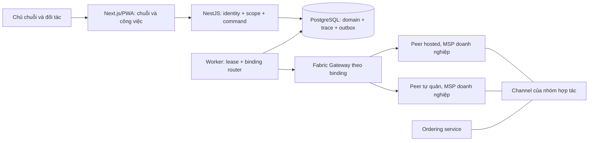
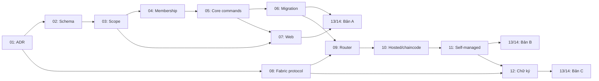

# Kế hoạch triển khai Hybrid Fabric và doanh nghiệp chủ chuỗi

> Cập nhật phạm vi 14/10/2026: [kế hoạch cài mới](fresh-install-cleanup-2026-10-13.md)
> và [ADR-004](../adr-004-hybrid-binding-and-signatures.md) quyết định bản phát hành
> hiện tại. Giữ bảng HYB-AC và business decisions bên dưới; các đề xuất crypto/
> topology chưa được ADR-004 chọn không được mô tả là đã triển khai. Production
> cài DB/mạng mới, giữ backup đã restore; không backfill dữ liệu test cũ. Chủ dự án
> đã cho phép merge/deploy sau kiểm thử, không giới hạn 2 giờ, không canary riêng,
> collector/24 giờ hoặc Agent trực sau bàn giao. Smoke trên VPS vẫn bắt buộc.

| Trường | Giá trị |
| --- | --- |
| Ngày lập | 11/10/2026, giờ Việt Nam |
| Review | R1 ngày 11/10/2026: sửa 10 khoảng trống/mâu thuẫn trong thiết kế; kiểm thử implementation vẫn là cổng riêng |
| Trạng thái | Hosted A/B/C đang qua cổng cài mới production; kết quả từng lần chạy ở PR/Issue hoặc artifact |
| Yêu cầu | Chủ chuỗi tự thực hiện một số công đoạn và thuê đối tác; doanh nghiệp dùng peer do AgriTrace quản lý hoặc peer tự quản |
| Baseline | Checkout `fd425e9f0047a70a91d1b5bb21198ebc9363e900`, cùng tài liệu đang được sửa trong working tree |
| Kiến trúc nền | NestJS modular monolith, PostgreSQL transactional outbox, Worker riêng, Fabric Gateway, Next.js/PWA |
| Quan hệ với core | Kế hoạch mở rộng; nghiệm thu core 03–30/10/2026 vẫn riêng, không mặc định thêm toàn bộ hybrid vào hạn 30/10 |

## 1. Mục tiêu, phạm vi và các bản bàn giao

Tiến độ và bằng chứng được ghi tại
[implementation record](https://github.com/KieuTanPhat/agri-trace-blockchain/blob/4d92f02122cbb0b4342372474f466c9146522365/docs/hybrid-chain-management-implementation.md).

AgriTrace cung cấp ứng dụng và dịch vụ Fabric. Mỗi chuỗi có một doanh nghiệp
điều phối; mỗi doanh nghiệp có thể làm nhiều công đoạn và tham gia nhiều chuỗi.
Chủ chuỗi phân công; bên thực hiện xác nhận nghiệp vụ trong phạm vi được giao.
Quyền điều phối không tự tạo quyền sở hữu hàng, custody, quyền ký thay đối tác
hoặc quyền quản trị Fabric của đối tác.

| Bản bàn giao | Kết quả sử dụng được | Giới hạn phải thể hiện |
| --- | --- | --- |
| A — Chủ chuỗi và đối tác | Chuỗi, lời mời/tham gia, nhiều năng lực trên một doanh nghiệp, quyền theo chuỗi, tự làm/thuê đối tác, QR/proof | Technical relayer vẫn có thể do AgriTrace ký; xác nhận đối tác ở mức ứng dụng |
| B — Hybrid Fabric | Org/MSP riêng hosted hoặc tự quản, channel phù hợp phạm vi chia sẻ, router outbox/proof; pilot có cả hosted và self-managed peer | Endorsement không tự chứng minh người dùng đồng ý với nghiệp vụ; AgriTrace có thể vẫn vận hành ordering service |
| C — Xác nhận độc lập | Khóa ký do doanh nghiệp kiểm soát, chữ ký ý định nghiệp vụ, chaincode kiểm bằng chứng/quyền, bàn giao có xác nhận hai bên | Proof/chữ ký không tự chứng minh chất lượng hàng hoặc sự kiện ngoài đời |

Đợt đầu dùng công đoạn đã có: sản xuất/thu hoạch, vận chuyển và bán lẻ. Giữ
`ProductionCycle → HarvestEvent → Lot → Shipment`, multi-harvest, quantity,
custody, compliance và QR. Workflow engine tùy ý, chế biến/đóng gói làm biến
đổi sản lượng, split/merge Lot, nhiều Shipment/Lot, user thuộc nhiều doanh
nghiệp, thanh toán và GPS realtime cần scope/task riêng, chưa nằm trong đợt này.

Lịch tính từ T0: ngày chốt baseline, capacity và môi trường thử. Sau review,
khoảng hoạch định tuần tự là 12–20 tuần với ba người có thời gian dành riêng;
8–12 tuần của bản đầu chưa có sizing theo owner/đường phụ thuộc nên không dùng
làm baseline cam kết. Các con số là ước lượng thiết kế, cần hiệu chỉnh sau
spike/schema đầu và chưa gồm thời gian chờ doanh nghiệp/infra. Nếu team tiếp
tục ưu tiên core 30/10 thì T0 hoặc mốc hybrid dịch theo capacity thực tế.

## 2. Hiện trạng và nguồn nghiệm thu

| Source/contract hiện tại | Khoảng cách với mục tiêu |
| --- | --- |
| Organization có một type FARM/TRANSPORTER/RETAILER/AUDITOR; DTO/OpenAPI phản ánh giới hạn này | Cần nhiều capability và vai trò theo chuỗi |
| User có một organizationId và roleId; guard/Web đọc một role | Cần scoped grants nhiều role; quyền hiện hành lấy từ server |
| Service/catalog và DB trigger yêu cầu Farm thuộc type FARM; Shipment kiểm type của Transporter/Retailer | Phải đổi cả DB, service, DTO và fixture |
| Cycle/Lot có farmOrgId; Shipment có transporterOrgId/retailerOrgId | Chưa có owner chuỗi/membership/chainId; giữ nghĩa org sản xuất, không thay thành chủ chuỗi |
| authorizeCommand và CommandCommit kiểm quyền trước replay và trong transaction | Phải bổ sung chain/membership/assignment vào scope và cơ chế khóa |
| Web auth-scope chỉ gồm user/role/org | Đổi chain/revoke cần bỏ dữ liệu và request của scope cũ |
| Fabric provider giữ một adapter; Gateway nhận một bộ cấu hình; proof query fallback channel từ env | Cần router và route lịch sử bất biến theo event |
| Writer dùng envelope 3.0.0, private hash schema 2.0.0/RFC8785; chaincode kiểm app.role=relayer | Cần chain/binding authorization; không suy ra mọi relayer được ghi mọi chuỗi |
| actorAuthProof là fingerprint | Chưa có chữ ký độc lập của doanh nghiệp |

Đã đối chiếu [Prisma](../../apps/api/prisma/schema.prisma),
[organization DTO](../../apps/api/src/modules/organizations/dto.ts),
[catalog](../../apps/api/src/modules/catalog/catalog.module.ts),
[Shipment service](../../apps/api/src/modules/shipments/shipments.service.ts),
[command authorization](../../apps/api/src/common/idempotency/command-authorization.ts),
[Web scope](../../apps/web/src/lib/auth-scope.ts),
[Worker](../../apps/api/src/modules/blockchain-adapter/blockchain-worker.service.ts),
[Gateway config](../../blockchain/gateway/src/config.ts),
[chaincode](../../blockchain/chaincode/src/traceability-contract.ts) và
[OpenAPI sinh từ NestJS](../openapi/openapi.json).

Issue được đọc ngày 11/10/2026; acceptance/ownership lấy từ Issue hiện hành,
không dùng bảng task cũ trong PROJECT_CONTEXT làm nguồn thay thế:

| Issue | Owner hiện hành | Điều phải giữ hoặc quản lý thành scope mới |
| --- | --- | --- |
| [AGT-007](https://github.com/KieuTanPhat/agri-trace-blockchain/issues/19) | Tuấn | Admin không ghi thay actor; Auditor đọc theo scope |
| [AGT-008](https://github.com/KieuTanPhat/agri-trace-blockchain/issues/20) | Phi | Farm/type FARM là AC core hiện tại; capability nhiều giá trị là thay đổi mới |
| [AGT-009](https://github.com/KieuTanPhat/agri-trace-blockchain/issues/21) | Tuấn | Actor evidence và privacy; chữ ký độc lập là năng lực bổ sung |
| [AGT-010](https://github.com/KieuTanPhat/agri-trace-blockchain/issues/22) | Phi | NestJS Swagger/response DTO/generated types tiếp tục là contract |
| [AGT-012](https://github.com/KieuTanPhat/agri-trace-blockchain/issues/24) | Phát | Core chọn technical relayer, không double signature mỗi Farm; bản C nghiệm thu riêng |
| [AGT-018](https://github.com/KieuTanPhat/agri-trace-blockchain/issues/30) | Phát | Giữ lease/retry/ordering/receipt khi thêm router |
| [AGT-019](https://github.com/KieuTanPhat/agri-trace-blockchain/issues/31) | Tuấn | Một Shipment/Lot, assignment và lượng hàng đã chốt không được thay trực tiếp |
| [AGT-026](https://github.com/KieuTanPhat/agri-trace-blockchain/issues/38) | Phi | Compliance chỉ actor được duyệt; bổ sung independence khi org có nhiều capability |
| [AGT-027](https://github.com/KieuTanPhat/agri-trace-blockchain/issues/39) | Phi | Public projection đúng Lot, proof và privacy |
| [AGT-031](https://github.com/KieuTanPhat/agri-trace-blockchain/issues/43) | Phát | Rehearsal, readiness và rollback bảo toàn dữ liệu |

Các Issue trên đang Open tại thời điểm đọc; source đã có và acceptance là hai
thông tin riêng. Mã HYB dưới đây chỉ là work package của plan, chưa phải AGT
Issue đã tạo. Lượt lập kế hoạch không đổi GitHub/Project/Sheet/Drive.

## 3. Kiến trúc dữ liệu và quyền mục tiêu



### 3.1. Schema đề xuất

| Thành phần | Trách nhiệm/invariant |
| --- | --- |
| OrganizationCapability | Nhiều năng lực FARM/TRANSPORTER/RETAILER/AUDITOR; capability không tự cấp quyền user hoặc quyền đọc dữ liệu |
| SupplyChain | Đúng một ownerOrganizationId, status và version; chuyển chủ chuỗi cần quy trình riêng, chưa hỗ trợ ở bản A |
| ChainMembership | Chain–organization, lời mời, INVITED/ACTIVE/SUSPENDED/REVOKED, revision và audit; chỉ ACTIVE nhận việc mới |
| ScopedRoleGrant | User/org/chain tùy scope, role, thời hạn/revision và audit thu hồi; user vẫn thuộc một tổ chức trong đợt đầu |
| StageAssignment | Bên thực hiện trên aggregate cụ thể, version/trạng thái chấp nhận/lịch sử; FK cycle/lot/shipment theo loại, CHECK đúng một subject và unique assignment hiệu lực theo chain/subject/công đoạn |
| ShipmentPlan | Bản nháp chain/Lot, proposed parties/route/quantity, revision và chấp nhận từng bên; có thể hủy/sửa nháp; finalize tạo đúng một Shipment bất biến dưới khóa Lot |
| ProductionCycle.chainId | Scope gốc; Harvest/Lot/Shipment thừa kế từ quan hệ; nếu denormalize chainId phải có composite FK/check nhất quán |
| EventChainContext | Sidecar bất biến eventId–chainId–scopeVersion; bổ sung scope legacy mà không sửa event/hash |
| FabricNetworkBinding | Network/channel/chaincode/contract, protocol version, profile và identity reference; version hóa, không chứa private key |
| EventLedgerRoute / DeliveryAttempt | Route event pin network/channel/contract/protocol và logical writer authority; attempt lưu credential/cert fingerprint/txID thực dùng; đổi cert hợp lệ không chuyển ledger đích |
| LedgerPermissionSync / DeliveryHold | Theo dõi revision quyền yêu cầu/đã confirmed trên ledger, activation/revocation barrier và lý do hold; hold không phải proof, không xóa event |
| ActorSigningKey / ActorAssertion | Public key/cert registry, authority/revocation và assertion cho bản C; khóa riêng ở phía doanh nghiệp hoặc dịch vụ được ủy quyền rõ |
| SigningIntent / HandoverConfirmation | Bản C: ý định bất biến, ID/expiry/expected version và assertion digest; handover OFFERED/CONFIRMED/REJECTED/EXPIRED/CANCELLED có transition audit; không sửa assertion đã ký |

Schema triển khai theo bản: HYB-02 chỉ phần A và logical route legacy tối thiểu;
HYB-08/09/10 thiết kế/apply phần binding/ledger synchronization của B; HYB-12
thêm signer/intent/handover của C. Không tạo schema crypto/Fabric đầy đủ trước
khi protocol tương ứng được chốt. Mọi FK scope phải chứng minh user thuộc org,
org là member của chain và subject/assignment cùng chain; nullable chain scope
của org grant cần CHECK scope kind và uniqueness cho NULL bằng partial indexes
hoặc cơ chế tương đương, không chỉ composite unique mặc định.

StageAssignment dùng công đoạn cố định và state machine hiện có. Khi tạo cycle,
ghi assignment sản xuất cùng transaction; tổ chức thực hiện phải đúng tổ chức
sở hữu Farm trong scope đầu tiên. Thuê đối tác canh tác trên Farm đứng tên
doanh nghiệp khác cần quyền sử dụng Farm riêng, chưa nằm trong mặc định này.
ShipmentPlan thu nhận sự đồng ý của org sản xuất và các bên thực hiện; finalize
kiểm membership/capability/grant, state/version và available quantity hiện tại,
tạo Shipment/assignment/trace/outbox cùng transaction dưới khóa Lot. Sửa nháp
làm mất hiệu lực chấp nhận revision cũ. Không giữ khóa lượng hàng chỉ vì có nháp.
Chủ chuỗi quản lý kế hoạch; command start/arrive/receive vẫn đúng actor thực hiện.

Chỉ hủy/thay ShipmentPlan trước finalize. Shipment đã tạo, kể cả CREATED, không
được đổi assignment/route/quantity hoặc tạo Shipment thứ hai cho cùng Lot:
`lotId @unique` và trigger hiện tại chặn cả hai cách này. Không xóa Shipment
để tái tạo. Giao lại việc hoặc cứu một Shipment tạo sai là recovery ngoài scope
đầu; giữ incident/evidence, không sửa dữ liệu gốc để vượt guard.

Farm có cycle của nhiều chain; thấy một cycle không cho phép xem mọi cycle của
Farm. Đối tác là pháp nhân dùng chung giữa các chain, không sao chép Organization
mỗi lần tham gia. Chain và assignment tạo ranh giới cách ly vận hành.

### 3.2. Ma trận quyền

| Quyền | Scope và thao tác |
| --- | --- |
| SYSTEM_ADMIN | Nền tảng: identity/masterdata/network; không mặc nhiên ghi nghiệp vụ |
| ORG_ADMIN | Tổ chức của mình: user, capability được phép, chấp nhận lời mời; không cấp quyền nền tảng hoặc quyền org khác |
| CHAIN_MANAGER | Chuỗi được giao: mời, phân công, lập kế hoạch, projection điều phối; không xác nhận thay partner |
| FARM_STAFF / TRANSPORTER / RETAILER | Chain và nhiệm vụ được giao: command đúng tổ chức/tài nguyên/state/version |
| AUDITOR | Đọc theo scope được cấp; không tự đọc mọi chuỗi |
| COMPLIANCE_REVIEWER | Scope được cấp và Farm assignment: giữ independence/self-review/correction rules |
| Consumer | Public QR theo token, không membership/Fabric identity |

Bootstrap: org admin được cấp quyền CREATE_CHAIN ở scope org tạo chain, owner
membership ACTIVE và grant CHAIN_MANAGER cho người tạo trong cùng transaction;
không tự cấp business roles. Owner chỉ đề xuất assignment; org nhận việc quản
lý user thực hiện của mình. ORG_ADMIN chỉ cấp business role trong capability và
membership đã được cho phép; không tự cấp SYSTEM_ADMIN, reviewer, auditor
authority hoặc quyền org khác. AUDITOR capability/reviewer authority do nền
tảng provision theo kiểm chứng độc lập; chain manager không tự tạo reviewer.

Chủ chuỗi tự làm công đoạn phải có capability, assignment và user role thực
hiện. Một user nhiều role được server xác định quyền theo command/assignment,
không chọn một global role làm căn cứ duy nhất. Bàn giao cùng công ty là xác
nhận nội bộ, không gắn nhãn độc lập giữa hai doanh nghiệp. Custody giữ cả org
và công đoạn/role thực tế; cùng org có ba capability không được dùng phép tìm
theo org ID để suy ra rằng custodian luôn là FARM_STAFF. Reviewer org phải khác
org sản xuất/đệ trình và kiểm self-review trên toàn chuỗi correction, kể cả
đổi user/role; actor của công ty sản xuất không tự review qua AUDITOR capability.

JWT xác thực sub/session; server đọc quyền hiện hành. Chain context từ URL/body/
UI phải khớp chain của resource và grant. Kiểm list/search/export/count, relation
lookup, proof, IoT và compliance. Membership không cho partner xem toàn bộ dữ
liệu riêng của chain; owner xem projection điều phối, không tự xem giá/hợp đồng
riêng của partner. Reviewer assignment phải được kiểm cùng chain của subject.

Dùng policy chung ở guard, OrganizationAccessService, command service,
authorizeCommand, presenter và allowedCommands. Kiểm lại dưới khóa transaction
và trước replay. Chốt thứ tự khóa org/user → membership/grant → assignment →
aggregate; revoke dùng cùng giao thức để không commit command sau khi quyền
đã bị thu hồi. Không dùng TTL cache quyền nếu thiếu invalidation liên instance.

Giữ unique idempotency hiện có khi chuyển đổi; bind chain/resource/scope revision
vào fingerprint. Cùng key trên chain khác trả conflict, không replay response
chain trước. Scope hash có version; bridge legacy kiểm quyền hiện hành và đọc
journal cũ, không viết lại journal. Fingerprint dùng quyền thực sự của command,
không dùng toàn bộ effective-role set hoặc revision UI toàn cục: thêm role không
liên quan không làm mất replay hợp lệ. Nếu cùng key cần reconcile thì không
tự execute lại. Worker relay event trước revoke theo barrier ở mục 4.3; normal
offboarding và emergency compromise có quy tắc khác nhau, đều giữ lịch sử.

Web dùng permissions/allowedCommands từ server, scope theo user/org/chain/access
revision. Đổi chain/account/revoke phải hủy request và bỏ response scope cũ,
kể cả nhiều tab. Giữ private API/trace ngoài service worker cache.

### 3.3. API và Web dự kiến

Đây là thiết kế interface để implement, chưa phải API đã phát hành. Sửa
DTO/controller/response metadata rồi sinh OpenAPI và Web types, không viết
contract JSON hoặc sửa generated types bằng tay.

| Interface dự kiến | Hành vi |
| --- | --- |
| GET/POST `/api/supply-chains`, GET `/api/supply-chains/:id` | List scope được phép, tạo chuỗi của org được cấp quyền |
| GET/POST `/api/supply-chains/:id/memberships` | Owner mời org hiện có; directory trả field tối thiểu |
| POST `/api/chain-memberships/:id/accept`, `/suspend`, `/revoke` | Đúng thẩm quyền, version, audit; không xóa history |
| GET/POST `/api/supply-chains/:id/assignments` | Subject đúng chain/capability, xác nhận bên nhận qua command riêng |
| ShipmentPlan create/revise/accept/cancel/finalize | Revision acceptance rõ; finalize duy nhất theo Lot, không coi revise nháp là update Shipment |
| Capability/scoped grant management và permission context | Org/chain/platform authority đúng matrix; không trả secret/key |
| Cycle/harvest/Shipment/Lot/proof hiện có | Scope lúc tạo/suy ra lúc thao tác; giữ state/quantity/idempotency/envelope |
| Binding/onboarding status | Trang kỹ thuật cho người có quyền; user nghiệp vụ không phải chọn MSP/channel |
| Signing intent/confirmation — bản C | Chuẩn bị ý định từ command/resource đã kiểm scope, ký ở signer doanh nghiệp và nộp assertion; intent preparation chưa là domain commit, confirmation đúng handover |

Write mới có Idempotency-Key, optimistic version và audit cùng transaction.
Giữ error conventions 400/401/403/404/409/422; resource ngoài scope dùng chính
sách nhất quán tránh dò tồn tại. Membership/capability/grant có audit quản trị,
không tự biến mọi masterdata write thành TraceEvent truy xuất.

Web thêm chọn chain, thành viên/lời mời, work queue, owner dashboard và org admin.
Consumer QR tiếp tục không cần login/wallet.

### 3.4. Phạm vi mã nguồn khi implementation

| Khu vực | File/module chính và phần cần bổ sung |
| --- | --- |
| DB | `apps/api/prisma/schema.prisma`, migration mới, fixture/backfill script riêng; không sửa migration đã apply |
| Chain và tổ chức | Module mới `apps/api/src/modules/supply-chains/`; tổ chức/user/catalog hiện có thêm capability/grant và invitation/assignment service |
| Auth và replay | `modules/auth/auth.types.ts`, `jwt-auth.guard.ts`, `roles.guard.ts`, `organization-access.service.ts`, `compliance-scope.ts`; `common/idempotency/command-authorization.ts` và scope/journal handling |
| Nghiệp vụ | ProductionCycle, lot-harvest/commands/query/custody/action policy, ShipmentPlan/Shipment, compliance, IoT và trace/evidence; mỗi command resolve chain/assignment/role thực hiện |
| Web | `apps/web/src/lib/auth-store.tsx`, `auth-scope.ts`, `permissions.ts`, API client/generated types; app-frame và các trang chain/task/org mới |
| Blockchain | Worker/provider/proof-query trong API; `blockchain/gateway/src/config.ts`, `connect.ts`, `adapter.ts`; chaincode types/validation/contract/ledger và network runbook |
| Signer | Unsigned intent, authority/assertion, handover; versioned trace-hash/trace-evidence/Worker/readers/public aggregation, DTO, ledger registry và Web confirmation |
| CI/CD | `scripts/generate-api-contract.mjs`, `scripts/ci/fabric-integration.mjs`, worker-contract tests, workflows application/blockchain; cutover compatibility theo `deploy/cd/policy.py` |

Đường dẫn module mới là đề xuất; đường dẫn hiện có được đối chiếu trong lượt
lập plan. Actor/event schema và role compatibility phải cập nhật cùng consumers,
không để controller guard tiếp tục chặn user nhiều scoped role bằng global role.

## 4. Hybrid Fabric và chữ ký

### 4.1. Profile và governance

| Profile | Trust model và điều kiện đạt |
| --- | --- |
| SERVICE | Relayer/peer AgriTrace; partner nhỏ không cần chạy peer; hiển thị nền tảng xác thực/gửi và ghi ủy quyền |
| MANAGED_ORG | Org/MSP riêng, peer hosted; phân định key/CA/admin authority, tách storage/secret/network và kiểm export/restore; hosting không tự tạo độc lập |
| SELF_MANAGED_ORG | Doanh nghiệp kiểm soát MSP/CA authority, peer/admin/signing key; AgriTrace không giữ private key độc lập; join/TLS/sync/endorse/query/revoke đạt |

Profile/mapping theo network/channel có lịch sử; một org nghiệp vụ có thể dùng
SERVICE ở chain này và Org riêng ở chain khác. API/Web không giữ Fabric signing
key; secret reference chỉ Worker/signer đúng scope resolve. Doanh nghiệp kiểm
soát authority cấp identity của mình; managed contract ghi rõ quyền ủy quyền.

Pilot có AgriTrace Org, một doanh nghiệp Org riêng và một partner SERVICE;
thử hosted và self-managed trên cùng scenario. Chuyển hosting cùng Org/channel
giữ ledger và quyền. Không dùng script test-network làm runbook production.

Channel membership, chaincode lifecycle và ModPolicy có đề xuất/chữ ký/version/
audit. Profile độc lập cần admin doanh nghiệp ký thay đổi ảnh hưởng phần được
bảo vệ của mình; AgriTrace không được đơn phương nới policy rồi quảng bá cùng
mức độc lập. Tách platform admin, channel/orderer admin và chain manager.

AgriTrace có thể vận hành ordering service ban đầu. Production HA đề xuất ba
Raft orderer ở các miền lỗi khác nhau sau khi có ngân sách/rehearsal. Raft chịu
lỗi dừng node; ordering tập trung vẫn là phụ thuộc availability, không quảng
bá như cơ chế chống mọi hành vi gian lận.
[Fabric ordering service](https://hyperledger-fabric.readthedocs.io/en/release-2.5/orderer/ordering_service.html).

### 4.2. Privacy, channel và endorsement

Pilot mới mặc định một channel cho một nhóm hợp tác có cùng phạm vi chia sẻ;
nhiều chain chỉ dùng chung khi các bên chấp nhận thấy metadata của nhau. Không
tạo channel/Lot. Chuỗi cần cách ly ledger dùng channel riêng; chainId trong API
không che ledger của peer. Offboarding không xóa bản ledger bên kia đã tải.

PII, giá, nghiệp vụ chi tiết và raw sensor ở PostgreSQL/object storage; public
state chỉ hash/opaque identifiers/phiên bản/metadata đã review. PDC chỉ thêm
khi chaincode cần dữ liệu riêng giữa một số Org; kiểm hash/metadata leakage và
private-data availability. Peer mới thấy public history của channel: không
join khách hàng mới vào channel legacy chứa lịch sử unrelated.
[Fabric private data](https://hyperledger-fabric.readthedocs.io/en/release-2.5/private-data/private-data.html).

Pilot có Org độc lập đề xuất endorsement của peer AgriTrace và peer chủ chuỗi.
Không yêu cầu tất cả partner ký mọi event. Chốt policy theo asset/stream;
create key cần bảo vệ ngay lần ghi đầu vì SBE gắn cho key mới không tự bảo vệ
lần create. Append event update stream head được bảo vệ; kiểm cả event/proof/
head/index để không vượt qua namespace khác. Endorsement xác nhận kết quả
chaincode, không thay chữ ký xác nhận nghiệp vụ.
[Fabric endorsement policies](https://hyperledger-fabric.readthedocs.io/en/release-2.5/endorsement-policies.html).

### 4.3. Router và proof

- Registry/pool keyed bằng network/channel/contract/MSP/identity/credential
  revision, có close/rotation; env chỉ bridge route legacy đã đăng ký.
- Snapshot route cùng transaction domain/trace/outbox. Query proof dùng route
  event; không dùng cấu hình chain hiện tại hoặc fallback sang channel khác.
- Identity pin là logical authority/MSP/role, không là private-key file hoặc
  cert revision bất biến. Cert hết hạn/rotate chọn credential mới được approve
  cho cùng authority, ghi DeliveryAttempt audit; không sửa route hoặc assertion
  của actor. Commit chưa rõ phải query/reconcile trước gửi lại; retire key cũ
  sau khi xử lý unknown attempts. Đổi MSP/authority cần workflow riêng.
- Giữ lease/predecessor/duplicate/VALID receipt và tuple/hash/channel checks.
  Head/receipt không trộn giữa chain/channel. Fairness/retry/health theo binding:
  peer một khách hàng lỗi không chiếm toàn bộ batch của khách hàng khác.
- Thiếu endorsement giữ Pending/retry; không hạ policy hoặc chuyển channel.
  Chaincode kiểm relayer MSP/identity, chain reference và channel binding qua
  registry ledger được bảo vệ; app.role=relayer riêng chưa đủ.
- Permission registry update on-chain phải confirmed trước write tương ứng;
  chaincode không tra PostgreSQL. Namespace/protocol/test vectors chốt HYB-08;
  giữ đọc v2/v3 legacy và private hash cũ, health kiểm writer capability.
- B/C dùng LedgerPermissionSync: REQUESTED/PENDING_LEDGER/ACTIVE hoặc
  REVOKE_REQUESTED/REVOKED. Grant chưa có confirmation không mở scoped write;
  DB và Fabric không được giả là một transaction atomic. Write của một permission
  epoch kiểm revision dưới khóa trước enqueue. Normal revoke chặn command mới
  ngay trên API, đặt barrier cho các event đã commit trong scope đó; drain và
  reconcile tất cả event thuộc epoch rồi mới commit revoke ledger. Fabric ngừng
  thì revoke ledger còn pending, API vẫn chặn quyền đã thu hồi.
- Emergency key compromise không drain mù: revoke ngay authority bị nghi ngờ,
  hold event chưa confirmed bằng reason/audit và đối soát; giữ PENDING kèm cảnh
  báo authorization review, không báo VERIFIED hoặc tự ký thay. Bảo vệ registry
  với governance phù hợp; revocation cùng event simulation phải dùng ledger
  reads/MVCC để không chấp nhận quyền cũ nếu registry đã đổi trước validation.
- A chỉ dùng DB authorization và route legacy; không quảng bá scope sidecar là
  chain binding đã được Fabric xác nhận. B/C mở quyền mới sau khi binding,
  registry và namespace bootstrap có proof; chưa đủ gate thì giữ profile cũ.
- Giữ chain/channel của stream đang chạy. Peer relocation trong cùng channel
  được phép; chuyển stream/channel cần task checkpoint/history-segment riêng,
  không copy/re-anchor âm thầm.

### 4.4. Xác nhận độc lập — bản C

Signer hoặc remote signing service do doanh nghiệp kiểm soát ký ý định nghiệp
vụ; tách chữ ký này khỏi transaction signature của relayer và peer endorsement.
Không tự cấp/giữ khóa doanh nghiệp rồi gọi là chữ ký độc lập.

Ý định có command/event ID ổn định, chain/entity/operation, expected version,
payload digest, actor org/key ID, nonce, expiry và policy version. Kiểm chữ ký
trước commit; trong transaction đối chiếu state/version và ý định đã ký. Không
gọi network signer khi giữ khóa DB. Signer lỗi/expired/stale không tạo domain
write/outbox cho command yêu cầu ký.

Canonical unsigned body được ký trước; event hash schema mới sau đó bao bằng
chứng. Không ký hash đã bao chính chữ ký đó. HYB-08 phải chốt cấu trúc commitment
để chaincode kiểm được chữ ký ràng buộc đúng event hash mà không nhận private
businessData: unsigned digest bao chain/event/entity/operation/expected version,
payload digest và context; assertion digest cộng unsigned digest được ràng vào
public event commitment theo thuật toán có domain separation/phiên bản. Không
chỉ verify chữ ký của một digest rồi chấp nhận dataHash khác do relayer đưa vào.
API/Worker kiểm private body đến digest; chaincode kiểm commitment/public tuple;
với multipart intent, có Merkle/path hoặc cấu trúc commitment rõ trong spec.
Algorithm/encoding/field order là gate của HYB-08, không suy từ tên DIGITAL_SIGNATURE.

Legacy `privateTraceEvidenceMatches` hiện yêu cầu actorAuthProof dạng 64 hex,
Worker/chaincode khóa phiên bản cụ thể. Bản C phải có schema-dispatched readers,
validators/hash vectors và rollout compatible; chữ ký thật không được nhét vào
field fingerprint rồi đổi regex chung cho legacy. Public verification package
tách phần evidence có quyền đọc với projection QR; thiếu evidence không tự
đánh dấu actor signature VERIFIED. Event cũ giữ hash/trust level cũ.

Ledger registry đủ để kiểm key/cert/scope/policy/replay. Assertion cần verify
có thể qua transient; public state chỉ projection/digest đã review, không
token/password/key. Expiry intent kiểm lúc nhận command; ledger kiểm chữ ký
và permission epoch theo barrier/incident rule mục 4.3. Không dùng eventTime
do actor cung cấp như bằng chứng độc lập rằng đã ký trước revoke. Nếu cần bằng
chứng thời điểm độc lập phải có timestamp/acceptance protocol riêng; receipt
AgriTrace ký chỉ là chứng thực tiếp nhận của nền tảng. Chaincode không dùng
Date.now(), API call hoặc trạng thái ngoài ledger cho quyết định endorsement.

Handover liên doanh nghiệp có intent bên giao và confirmation bên nhận, cùng
handover ID và quantity, version của từng command/subject. Chốt ma trận C:
pickup Farm→Transporter đủ hai bên mới thực hiện START_SHIPMENT; arrival
Transporter→Retailer đủ hai bên mới thực hiện ARRIVE_SHIPMENT và chuyển custody
sang Retailer. Trước confirmation, shipment/lot/custodian vẫn ở trạng thái
trước; Web hiển thị handover pending riêng. RETAIL_RECEIVED tiếp tục là nghiệm
thu lượng/chất lượng sau khi nhận custody, không đồng nhất với xác nhận arrival.
Offer timeout/reject/cancel giữ hàng và state trước, không tự chuyển custody;
confirm vs expiry/recall/damage/revoke dùng cùng aggregate lock/version.

Không bật C giữa một handover đang thực hiện. Profile/protocol mode được pin
cho stream lúc tạo; chọn stream mới hoặc checkpoint riêng. Các command A/B
không được gọi trực tiếp để bypass dual confirmation của C. SERVICE ký ủy quyền
và cùng org là nội bộ; actor signature status tách proof integrity/business state.

## 5. Work packages và phân công đề xuất

Owner HYB là đề xuất theo chuyên môn/AGT ownership, chưa là assignment mới.
Trước T0 ghi Issue, người nhận việc, reviewer và capacity. Mỗi task có PR,
acceptance/evidence riêng; không ép owner làm đồng thời shared contract.

| Mã | Đầu ra | Owner đề xuất; reviewer | Phụ thuộc | Cổng đạt |
| --- | --- | --- | --- | --- |
| HYB-01 | ADR bổ sung ADR-001, scope/role/data/trust matrix, pilot/baseline/Issue mapping | Phát; Tuấn + Phi | — | A/B/C và lựa chọn privacy/trust/pilot rõ |
| HYB-02 | Schema A, ShipmentPlan, scope constraints, route legacy tối thiểu, fixtures/migration draft | Tuấn; Phát + Phi | 01 | DB mới/copy, cross-chain FK/unique/check, legacy hashes |
| HYB-03 | Policy scope/grants/revoke/concurrency và idempotency bridge | Tuấn; Phát + Phi | 02 | HYB-AC-02/03/05 dưới đây đạt |
| HYB-04 | Bootstrap chain, membership/invite/accept, ShipmentPlan/assignment và audit | Tuấn; Phát | 03 | Owner/partner/self-execution, acceptance revision và race đúng |
| HYB-05 | Tích hợp catalog/cycle/Lot/ShipmentPlan finalize/compliance/IoT, response/allowedCommands | Tuấn; Phát + Phi | 04 | Nhiều công đoạn/org, custody role và độc lập reviewer; core invariants |
| HYB-06 | Backfill manifest/legacy bridge/rehearsal/compatibility A | Phát + Tuấn; Phi | 02, 03, 05 | Mapping active đầy đủ; unresolved chặn; hash/QR/replay còn |
| HYB-07 | Web chọn chain/role, lời mời/work queue/dashboard/org admin, generated contract | Phi; Tuấn + Phát | 03, 04; hoàn tất sau 05 | Đổi chain/tab/mobile/public QR đạt |
| HYB-08 | Protocol/B-C schema design, binding/registry/permission sync, privacy/governance và signature commitment | Phát; Tuấn + Phi | 01 | Create-key/rotation/revocation policy, compatible versions và vectors review |
| HYB-09 | Schema B/router/pool, event route/attempt, permission sync/barrier và proof lookup | Phát; Tuấn | 05, 06, 08 | Đúng ledger đích, rotation/backlog và DB-ledger consistency |
| HYB-10 | Chaincode scope/version và MANAGED_ORG pilot, production-oriented runbook | Phát; Tuấn | 08, 09 | Real Fabric commit/query/duplicate, policy negatives |
| HYB-11 | SELF_MANAGED_ORG join/sync/approve/rotate/revoke/restore, chuyển hosting | Phát; Tuấn + doanh nghiệp pilot | 10 | Peer bên doanh nghiệp query/endorse thật, key authority đúng |
| HYB-12 | Schema C/signer/commitment verification, versioned readers và handover state machine/UI | Phát + Tuấn; Phi | 05, 08, 10, 11 | Binding signature-event, dual confirmation, mixed-version và outage đạt |
| HYB-13 | E2E/regression/privacy/fault injection/load/restore/evidence A/B/C | Team; review chéo | A: 05–07; B: 09–11; C: 12 | AC bản release đạt cùng SHA, mock không thay Fabric evidence |
| HYB-14 | Canary/cutover/monitor/rollback/runbook/handoff A/B/C | Phát; Tuấn + Phi | 13 của bản tương ứng | Rehearsal, compatible rollback, pilot nghiệm thu |



## 6. Lịch theo cổng đạt

Các khoảng ngày dưới đây là sizing thiết kế ban đầu cho đoạn phụ thuộc chính,
không là năng suất đã đo. Bản đầu cộng số người như thể backend/Fabric có thể
làm hoàn toàn song song; thực tế HYB-02→06 chủ yếu qua Tuấn và HYB-09→11 qua
Phát. Dùng khoảng tuần tự dưới đây để hoạch định, đo lại sau HYB-01/02; việc
prepare protocol/UI có thể chồng lấp nhưng review, integration và capacity vẫn
được tính. Không dùng 8–12 tuần cũ để cam kết với đối tác.

| Đoạn | Ngày làm việc dự kiến | Cách tính/owner chính |
| --- | --- | --- |
| ADR/baseline (HYB-01) | 2–3 | Baseline/ADR/pilot sizing; Phát và review team |
| HYB-02 + 03 | 9–14 | Schema 4–6 + scope/replay 5–8; Tuấn |
| HYB-04/05/06 + kiểm/release A | 17–27 | 4–6 + 7–10 + 3–5 + 2–4 + 1–2; backend/migration/review |
| HYB-09/10/11 + kiểm/release B | 18–31 | 5–8 + 6–10 + 4–7 + 2–4 + 1–2; Phát/pilot |
| HYB-12 + kiểm/release C | 11–18 | 8–12 + 2–4 + 1–2; Phát/Tuấn/Phi phối hợp |
| Handoff cuối | 2–3 | Restore/evidence/signoff/monitoring sau candidate cuối |

Tổng đường tuần tự 59–96 ngày làm việc, khoảng 12–20 tuần theo tuần năm ngày.
HYB-07 ước 8–12 ngày và HYB-08 4–6 ngày chuẩn bị chồng lấp; nếu không đủ
capacity hoặc protocol chưa đạt gate thì cộng thời gian chờ, không tự trừ khỏi
critical path. Procurement/onboarding và sửa lỗi sau UAT chưa có dữ liệu để
ước lượng chính xác. Phân công hiệu chỉnh trong HYB-01, không coi con số này
là deadline đã được team nhận.

| Giai đoạn | Điều kiện/cửa sổ | Công việc | Kết quả |
| --- | --- | --- | --- |
| G0 | 2–3 ngày đầu | 01, thiết kế 02/08, mapping/capacity | Pilot, privacy/trust, role/command matrix và ADR đủ để code |
| G1 | Sau G0; 9–14 ngày | 02/03: schema/scope/replay | DB/auth/revoke matrix đạt; chưa bật quyền mới trên môi trường chung |
| G2 | Sau G1; 17–27 ngày, Web chuẩn bị từ G1 | 04–07, 13/14 cho A | Chủ chuỗi/đối tác, migration và QR lịch sử đạt |
| G3 | Sau A và HYB-08; 18–31 ngày | 09–11, kiểm thử B | Hosted + self-managed thật, rotation/barrier/privacy/governance đạt |
| G4 | Sau B và crypto vectors; 11–18 ngày | 12 và kiểm thử C | Chữ ký-event binding và handover state machine đạt |
| G5 | Sau candidate cuối | Deploy/smoke/handoff | CI/CD đúng SHA và smoke thực trên VPS; kết thúc sau bàn giao |

Shared Prisma/OpenAPI/actor/proof types có thứ tự merge và người điều phối.
Một người làm toàn bộ cần lập lại lịch theo effort toàn bộ task; không dùng
critical-path estimate của ba người. Bản A có thể bàn giao trước khi B/C xong.

## 7. Migration và bảo toàn lịch sử

1. Manifest ID/mapping/count/hash: org/user/role/Farm/cycle/harvest/Lot/Shipment/
   trace/outbox/proof/binding. Xác nhận chủ chuỗi từ nghiệp vụ; không suy ra
   từ transporter hoặc org relayer. Dữ liệu nhiều farmer/retailer cần mapping
   riêng; manifest không chứa secrets hoặc PII không cần thiết.
2. Backfill capability từ type cũ; giữ type/role legacy cho bridge. Migration
   mới đổi Farm trigger và Shipment validation sang capability; giữ audit
   protections chung, không sửa applied migration/checksum.
   Checklist SQL gồm fn_validate_farm_organization_type và
   fn_validate_shipment_insert (DB vẫn kiểm type), scope FK/uniqueness và
   protections của sidecar. Giữ fn_lock_shipment_assignment chặn assignment/
   route/quantity, không vô hiệu hóa để hỗ trợ sửa nháp. Seed/fixture và
   authorization/presenter/catalog cùng chuyển capability đúng bản.
3. Thêm chain/membership/grant/assignment/context/route. Grant cũ chỉ chuyển
   vào scope có evidence, không cấp mọi chain theo suy đoán. Auditor legacy
   cần mapping scope; SYSTEM_ADMIN vẫn là platform authority.
4. Mỗi active root/child resolve duy nhất; unresolved register chặn write/
   cutover phạm vi liên quan. Backfill dry-run, idempotent/resumable/reconcile;
   NOT NULL/FK/check cuối chỉ apply sau khi mapping đạt.
5. Giữ event IDs/payload/actor/hash/previous hash/canonicalization/QR/proof/txID.
   Sidecar thêm scope không nâng trust hoặc rehash history để thêm chainId.
   Manifest mapping canonical có digest/reviewer và bản evidence ở kênh độc
   lập; sidecar phải đối chiếu mapping đó. Legacy proof chỉ bao tuple cũ,
   không chứng minh chainId mới. Nếu anchor manifest thì ghi checkpoint mới
   riêng, không sửa proof cũ. Mapping/route bị đổi trái manifest phải chặn
   access/cutover và phát cảnh báo, không tiếp tục coi scope mới đã được xác minh.
6. Pending legacy giữ route/version/nonce/eventId/hash; journal PROCESSING dùng
   bridge có version và kiểm quyền hiện hành. Không resolve được thì giữ
   unresolved, không phát key mới. Client không được chọn legacy mode để né scope.
7. Channel mới dành cho chain/stream mới cần cách ly; history legacy query route
   cũ. Không join peer mới vào shared history nếu chưa có quyền xem toàn bộ.
   Chuyển stream/channel cũ cần migration checkpoint task riêng.
8. Rehearsal DB trống và copy đã loại PII, có trigger/constraints thật; so counts/
   relations/hashes/QR/backlog trước–sau. SQL ngoài allowlist `deploy/cd/policy.py`
   đi cutover có review, không nới guard để auto deploy.
9. Bridge API/Worker/Web hiểu schema mở rộng và scope mới. Khi scoped writes
   đã bật, image chỉ hiểu global type/role không là rollback candidate. Cleanup
   legacy fields/paths ở PR riêng sau compatibility/retention review.

## 8. Ma trận nghiệm thu và kiểm thử

Dataset: A chủ hai chain, B đối tác của A và chain của D; A tự sản xuất/bán lẻ,
B vận chuyển. Có user nhiều role, user chỉ một task, reviewer độc lập/Consumer,
chain legacy và chain mới tách channel; hosted/self-managed peer ở host khác.
Có thêm org FARM+AUDITOR, org làm cả ba công đoạn, hai nháp tranh finalize cùng
Lot, expired relayer cert và quyền bị thu hồi khi Fabric outage.

| Acceptance | Scenario/expected outcome | Work package |
| --- | --- | --- |
| HYB-AC-01 | Một org FARM+TRANSPORTER+RETAILER thực hiện đủ core flow; legacy type không chặn capability hợp lệ | 02, 05, 07 |
| HYB-AC-02 | Owner điều phối, partner ghi task của mình; owner/admin không ghi thay; reviewer không self-review | 03–05 |
| HYB-AC-03 | Forged chainId/direct ID/list/filter/count/export/proof/IoT không lộ chain khác dù partner cùng tham gia | 03, 05, 07, 09 |
| HYB-AC-04 | Invite/accept/revoke/assign concurrent: đúng membership/capability/grant/state/version, không partial writes | 02–05 |
| HYB-AC-05 | Revoke/disable vs command/replay; JWT cũ không giữ quyền, same key khác chain không replay, journal legacy đối soát được | 03, 06 |
| HYB-AC-06 | Multi-harvest/Lot/QR, quantity/custody/damage/receive/sale/recall/expiry/compliance giữ core invariant | 05, 13 |
| HYB-AC-07 | Backfill resume/rerun/unresolved, DB protections; history hashes/QR/proof bất biến, Pending cũ drain | 02, 06, 09 |
| HYB-AC-08 | Đổi chain/account/tab khi request pending: không nhận response cũ, private/offline cache không lộ; mobile dùng được | 07 |
| HYB-AC-09 | Đúng network/channel/MSP/contract; hash đúng nhưng route sai bị chặn; config change không redirect backlog | 08–10 |
| HYB-AC-10 | Một binding outage, binding khác tiếp tục; API Pending, restart/stale lease/unknown commit/duplicate không mất hoặc trùng event | 09–11 |
| HYB-AC-11 | Peer tự quản join/sync/query/endorse; thiếu endorsement/trái MSP/role/create-key/head policy không commit VALID | 08, 10, 11 |
| HYB-AC-12 | Channel/PDC/public allowlist không lộ dữ liệu cấm; onboarding không mở unrelated history; offboard không claim xóa ledger cũ | 08, 10, 11 |
| HYB-AC-13 | Rotate/revoke/admin approval/peer relocation/backup restore; key độc lập không copy vào API/AgriTrace Worker | 10, 11 |
| HYB-AC-14 | Signature sai actor/payload/chain/nonce/version/expiry/replay bị chặn; signer outage không commit write cần ký; delayed relay đúng policy | 08, 12 |
| HYB-AC-15 | Handover ràng quantity/version, thiếu confirmation không hoàn tất; same-org/ủy quyền có nhãn đúng | 05, 07, 12 |
| HYB-AC-16 | Restore/canary/rollback hiểu schema/protocol; QR/warnings đúng; load/backlog không làm lẫn scope | 13, 14 |
| HYB-AC-17 | Revise/cancel ShipmentPlan vô hiệu acceptance cũ; hai finalize chỉ một Shipment; đã CREATED không đổi org/route/lượng, không tạo Shipment thứ hai | 02, 04, 05 |
| HYB-AC-18 | Bootstrap chỉ grant được phép; ORG_ADMIN/CHAIN_MANAGER không tự nâng reviewer/platform role hoặc cấp grant sang org/chain khác; NULL-scope uniqueness/FK thật | 02–05 |
| HYB-AC-19 | Cert rotate/expiry khi queue Pending/unknown commit: credential hợp lệ cùng authority, route/hash/nonce cũ giữ; reconcile và attempt audit không tạo proof giả/trùng | 08–11 |
| HYB-AC-20 | Grant ledger chưa confirmed không mở write; revoke bình thường có barrier/drain; compromise hold/revoke ngay; race registry MVCC không dùng quyền stale | 08–12 |
| HYB-AC-21 | Hoán đổi chữ ký/unsigned digest/dataHash/event/chain/context bị chặn; private body-public commitment vectors khớp; legacy 64-hex evidence và reader/proof aggregation vẫn đúng | 08, 12, 13 |
| HYB-AC-22 | Sidecar/route chain legacy trái manifest bị chặn; proof legacy không được gắn trust chain/signature mới; actor thời gian backdated không vượt revoke | 06, 08, 09, 12 |
| HYB-AC-23 | Pickup/arrival chỉ đổi custody sau dual confirm của C; reject/timeout/recall/race không chuyển hàng ngầm; A/B endpoint không bypass C; không đổi profile giữa handover | 05, 07, 12 |
| HYB-AC-24 | Cùng org ba role vẫn resolve đúng custodian stage, cả FAILED; khác user trong org FARM+AUDITOR không self-review; Farm nhiều chain không rò compliance | 03, 05, 07, 13 |

Gate theo bản: A chạy HYB-AC-01–08, 17/18/22/24 trong scope A; B chạy lại
regression A và 09–13/19/20 cùng phần binding của 22; C chạy lại A/B và
14/15/21/23 cùng phần chữ ký của 22. HYB-AC-16 áp dụng mọi bản. AC chưa thuộc
bản release ghi Deferred cho bản đó, không ghi Passed thay năng lực chưa có.

Reuse core suites, thêm behavior/race/DB/integration tests có ý nghĩa. DB test/
copy riêng có protections thật; không seed/reset UAT/production. Mock dành cho
unit, không thay evidence Fabric/signer/peer tự quản thực tế.

Các lệnh hiện có từ root, chạy khi triển khai code work package:

```bash
npm run prisma:generate --workspace apps/api
npm run build --workspace blockchain/gateway
npm run api-contract:generate
npm run api-contract:check
npm run check
npm run test:worker-contract
npm run audit:dependencies
npm run check:chaincode:standalone
```

TEST_DATABASE_URL trỏ DB test đã migrate; Node/npm theo manifest/CI. Thêm real
Fabric scenarios vào scripts/workflows hiện có, không hạ coverage gate. Evidence
ghi SHA/image digest/migration checksum/network/channel/sequence/protocol/policy,
command/expected/actual/passed/failed/skipped/reviewer. Skip AC bắt buộc giữ
Not Evaluated, chưa chạy không ghi Passed.

## 9. Rollout, rollback và vận hành

Bật A → B → C theo chain/profile bằng config server có version; API/Worker/
chaincode cùng kiểm capability, không chỉ dùng frontend flag. Bản C không tự
downgrade sang SERVICE hoặc bỏ signature khi signer/peer lỗi.

1. Candidate/bridge rollback images qua CI, DB rehearsal và real Fabric.
   Review checksum/compatibility, provision role bằng script có version;
   không seed tài khoản thật hoặc đổi password để chạy canary.
2. Snapshot nhất quán PG + ledger/config/MSP/CA + off-chain evidence; mã hóa,
   restore môi trường cách ly; lưu counts/backlog/hash baseline.
3. Pause writer cần bảo vệ và Worker cũ khi cutover. Upgrade chaincode sequence
   và kiểm committed definition/capability trước writer protocol mới; upgrade
   peer không đồng nghĩa chuyển ledger/channel.
4. Apply schema/backfill đã review; kiểm mapping/constraints; deploy API →
   Worker → Web tương thích. Canary A rồi pilot B/C, kiểm scope/route/replay/
   Pending drain/public QR trước mở rộng.
5. Chạy smoke sau deploy, đối chiếu scope/route/signatures/outbox/proof/QR,
   runtime SHA và OOM/restarts. Không có cửa sổ quan sát liên tục hoặc Agent trực
   vận hành sau bàn giao. Workload/RPO/RTO/SLA chưa được đo không được tuyên bố đạt.
6. Quyền/route/privacy sai: dừng writes chain liên quan, pause binding, giữ
   evidence/backlog; đối soát journal/resource/ledger rồi sửa. Image rollback
   phải hiểu scope/envelope mới; nếu không dùng bridge/fix forward. Không xóa
   ledger/outbox, sửa hash/proof hoặc restore DB cũ như rollback app thường.
7. Normal offboard: chặn command mới trên API ngay → đối soát open custody/
   barrier các event đã commit → drain/reconcile rồi revoke ledger/credential
   theo governance. Giữ API bị chặn khi ledger còn pending; không cho phép
   quyền cũ tiếp tục vì đợi Fabric. Compromise revoke ngay và hold events cần
   review, không drain mù hoặc bảo đảm mọi Pending sẽ tự VERIFIED.
   Phân biệt membership của một chain với Fabric channel/Org membership: partner
   còn làm chain khác không bị revoke toàn bộ MSP/identity chỉ vì rời một chain.
8. Bàn giao hosted/self-managed runbook, key responsibility matrix, supported
   versions/recovery/backup/limits. Release môi trường chung theo gate hiện
   hành; lập plan không thực hiện deployment.

## 10. Thứ tự PR và bước đầu tiên

PR đầu implementation là HYB-01/HYB-02: ADR, role matrix, schema mở rộng,
migration draft và fixtures. Tiếp theo tách scope/replay, membership, core
commands, backfill, Web, Fabric protocol/router, chaincode/hosted, self-managed,
signer và evidence. PR behavior cập nhật docs và Swagger/generated consumers.

Theo quy tắc đặt tên nhánh theo mục đích, ví dụ `feature/hybrid-chain-scope`,
`feature/hybrid-fabric-routing`, `feature/hybrid-actor-signatures`; thêm AGT ID
khi có Issue thực. Dùng checkout/worktree phù hợp, giữ dirty changes người dùng
và không mang file ngoài scope vào PR hoặc reset để tạo baseline.

HYB-01 ghi giá trị pilot cụ thể: owner/partner, legacy mapping, privacy/channel,
hosting/key authority, grant authority, signer acceptance/revocation policy,
capacity và infra budget. Dùng mặc định trong plan làm thiết kế ban đầu; quyết
định ảnh hưởng dữ liệu/hạ tầng thật được ghi ADR/Issue và review trước cutover.
Đây là bước implementation tiếp theo, không phải yêu cầu xác nhận để hoàn
thành tài liệu kế hoạch.

Lượt lập plan chỉ đối chiếu source/Swagger/Issue, tạo tài liệu và kiểm liên kết/
tính nhất quán; chưa chạy application suites, migration, Fabric transactions,
partner onboarding hoặc cập nhật acceptance trên hệ thống ngoài repository.

Trước merge code từng phần: A cần role/bootstrap/schema/ShipmentPlan matrix;
B cần credential rotation/permission barrier/registry governance vectors;
C cần signature-event commitment, deterministic verification và handover matrix.
Protocol vectors chưa đạt là gate chưa đạt, không mô tả phần crypto đã hoàn tất
chỉ vì plan có tên bảng hoặc thuật ngữ chữ ký.

## 11. Tài liệu nền

- [PROJECT_CONTEXT — hiện trạng](../PROJECT_CONTEXT.md).
- [ADR-001 — API/Worker/outbox](../adr-001-modular-monolith-dedicated-worker.md).
- [Core implementation/evidence](https://github.com/KieuTanPhat/agri-trace-blockchain/blob/4d92f02122cbb0b4342372474f466c9146522365/docs/core-implementation-2026-10-10.md).
- [Core completion plan](https://github.com/KieuTanPhat/agri-trace-blockchain/blob/4d92f02122cbb0b4342372474f466c9146522365/docs/plans/core-completion-plan-2026-10-10.md).
- [API/Worker](../../apps/api/README.md), [Fabric runbook](../hybrid-fabric-runbook.md).
- [Fabric MSP](https://hyperledger-fabric.readthedocs.io/en/release-2.5/membership/membership.html): danh tính và quyền admin theo org/policy.
- [Thêm Org vào channel](https://hyperledger-fabric.readthedocs.io/en/release-2.5/channel_update_tutorial.html): cấu hình/chữ ký khi onboarding.
- [Fabric Gateway](https://hyperledger-fabric.readthedocs.io/en/release-2.5/gateway.html): endorsement/submit/commit integration.

## 12. Nhật ký review R1 — 11/10/2026

Review tĩnh của kế hoạch, source/Prisma/migrations, Issue AGT-019/026/012 và tài
liệu Fabric. P1 là khoảng trống có thể dẫn đến implementation sai quyền/dữ liệu/
bằng chứng; P2 là thiếu sót về trình tự/provenance/ước lượng. Trạng thái bên dưới
chỉ nói đã sửa thiết kế trong plan, không xác nhận code hay hệ thống đã đạt.

| Mã | Mức | Sai sót/khoảng trống bản đầu và căn cứ | Sửa trong plan / kiểm chứng khi implementation |
| --- | --- | --- | --- |
| R01 | P1 | Hủy rồi tạo Shipment thay thế mâu thuẫn `Shipment.lotId @unique`, service create và `fn_lock_shipment_assignment` | ShipmentPlan riêng, finalize duy nhất, Shipment đã tạo bất biến; HYB-AC-17 |
| R02 | P1 | ORG_ADMIN quản lý grants/capabilities chưa có trần quyền và bootstrap; FK/NULL grant scope chưa chỉ rõ | Authority matrix, owner bootstrap, không tự cấp platform/reviewer, scope FK/unique; HYB-AC-18 |
| R03 | P1 | Multi-capability phá independence ngầm FARM/AUDITOR; reviewer chỉ chống cùng user và custody code tìm theo org có thể nhầm role | Reviewer khác producer org và self-review toàn correction; custody theo stage/role; HYB-AC-24 |
| R04 | P1 | Pin identity/cert revision vào event route làm Pending bị kẹt khi cert rotate/expiry | Pin logical authority/ledger; credential theo attempt có audit/reconcile; HYB-AC-19 |
| R05 | P1 | DB revoke tức thời, registry revoke và relay event trước revoke chưa có ordering/activation protocol | LedgerPermissionSync, normal barrier/drain vs emergency hold, MVCC/race; HYB-AC-20 |
| R06 | P1 | Nói verify signature nhưng chưa yêu cầu commitment gắn signature với dataHash; evidence checker hiện chỉ 64 hex và version cụ thể | Protocol vectors, public-private commitment và version-dispatched hash/readers; HYB-AC-21 |
| R07 | P1 | Dual handover chưa chỉ ra thời điểm START/ARRIVE/custody đổi; có thể báo hoàn tất hoặc dùng endpoint A/B vượt confirm | Handover state machine và matrix C, timeout/race/profile pin; HYB-AC-23 |
| R08 | P2 | Schema HYB-02 bao cả B/C trước protocol HYB-08, reviewer/version rollout bị dồn vào PR đầu | Schema theo release, 08 thiết kế từ ADR, migrations B ở 09/10 và C ở 12; dependency table/DAG cập nhật |
| R09 | P2 | Sidecar chainId legacy chưa được ràng trong old hash; coi chain metadata mới là VERIFIED sẽ nâng trust sai | Manifest provenance/checksum độc lập, context guards, checkpoint riêng nếu anchor; HYB-AC-22 |
| R10 | P2 | 8–12 tuần chưa tính critical path/owner bottleneck và lượng việc signer/state machine | Sizing tuần tự 59–96 ngày, khoảng 12–20 tuần; capacity/spike/đối tác vẫn cần đo trước cam kết |

Căn cứ bổ sung:
[Shipment protections mới nhất](../../apps/api/prisma/migrations/20261010140000_lot_origin_evidence/migration.sql),
[DB shipment insert validation](../../apps/api/prisma/migrations/20260918120000_init_traceability_core/migration.sql),
[custody resolver](../../apps/api/src/modules/lots/lot-custody.ts),
[compliance](../../apps/api/src/modules/compliance/compliance.service.ts),
[hash input](../../apps/api/src/modules/trace/trace-hash.ts) và
[evidence checker](../../apps/api/src/modules/trace/trace-evidence.ts).

Sau sửa: 14 work packages, 24 nhóm AC; gate A/B/C chỉ đòi năng lực của bản đang
release và regression các bản trước. Các lựa chọn còn phải chốt khi code là
pilot/infra budget, protocol bytes/test vectors và capacity thực. Review này
không phải security audit hay bằng chứng runtime/Fabric/migration đã đạt.
